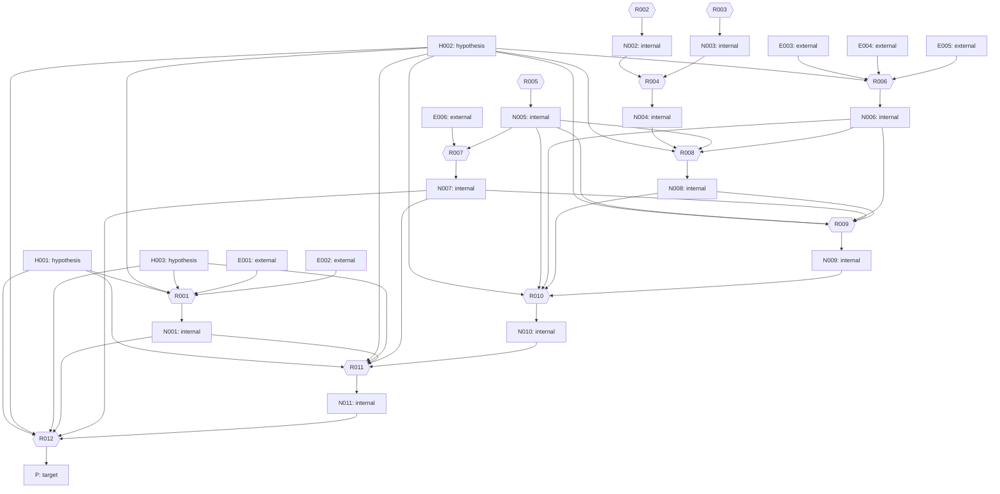

# NL0 — benchmark

> Generated from canonical nl0.json and spec.json. Do not edit this view.

## Frozen original target

Theorem 1 (Logarithm-free convergence), with the standing definitions of Section 2 of the supplied paper.

Use normalized measure dx/(2*pi) on the torus \mathbb{T} = \mathbb{R}/(2*pi \mathbb{Z}). The Fourier coefficient is
\hat f(k)=(2*pi)^(-1) integral_0^(2*pi) f(x) exp(-i*k*x) dx,
and ||f||_(H^s)^2=sum_(k in Z) <k>^(2s)|\hat f(k)|^2, where <k>=(1+k^2)^(1/2).
These spaces are the completions of trigonometric polynomials in these norms; negative spaces are interpreted as distributions. The normalized L^2 norm is the s=0 norm. For mean-zero functions, the homogeneous norm uses |k|^(2s) in place of <k>^(2s). For s>=0,
||f||_(dot H^s)<=||f||_(H^s)<=2^(s/2)||f||_(dot H^s);
for s<0, 2^(s/2)||f||_(dot H^s)<=||f||_(H^s)<=||f||_(dot H^s).
Real-valued means \hat f(-k)=overline(\hat f(k)), and mean-zero means \hat f(0)=0.
All time suprema concern continuous representatives; derivative norms are essential suprema.

Let S_t=exp(-t*partial_x^3), so \widehat{S_t f}(k)=exp(i*t*k^3)\hat f(k).
Let P_0 be the mean and P=I-P_0. Let D^(-1)=partial_x^(-1) have multiplier (i*k)^(-1) for k!=0 and zero at k=0; D^(-2)=(D^(-1))^2.
The equation is
u_t+u_xxx=(1/2)partial_x(u^2),  u(0)=u_0. [Eq. (1)]
The exact solution u is the unique real, mean-zero C([0,T];H^gamma) solution obtained by smooth approximation and satisfies this equation distributionally.

For a positive integer L and tau=T/L, the fixed time-semidiscrete scheme is u^0=u_0 and
u^(n+1)=S_tau u^n+F_tau(u^n)+H_tau(u^n), 0<=n<L, [Eq. (2)]
where
F_tau(f)=(1/6)P[(S_tau D^(-1)f)^2]-(1/6)S_tau P[(D^(-1)f)^2],
H_tau(f)=(1/3)P[(S_tau D^(-1)f)D^(-1)F_tau(f)]
 +(tau/9)(S_tau D^(-1)f)P_0(f^2)
 -(1/54)[S_(tau-s)D^(-1)[(S_s D^(-1)f)^3]]_(s=0)^(s=tau)
 -(1/(27*tau))[S_(tau-s)D^(-2)[(S_(s-tau)D^(-2)F_tau(f))(S_s D^(-1)f)]]_(s=0)^(s=tau).
Each bracket [G(s)]_(s=0)^(s=tau) means G(tau)-G(0).
This is the fixed scheme of the paper's reference [1, Eq. (1.4)], without a spatial frequency cutoff.

For every T>0, every 0<gamma<=1 and every R>0, there exist C>0 and tau_0>0 depending only on T,gamma,R such that, for every real, mean-zero u_0 in H^gamma(\mathbb{T}) with ||u_0||_(H^gamma)<=R and every positive integer L with tau=T/L<=tau_0, this exact fixed scheme satisfies
max_(0<=n<=L) ||u(n*tau)-u^n||_(L^2)<=C*tau^gamma.
The same C and tau_0 apply to the entire stated initial-data ball; no spectral support bound or additional smoothness is a hypothesis.

In the source's standing notation v(t)=S_(-t)u(t) and M=1+sup_(0<=t<=T)||v(t)||_(H^gamma).
Constants C_M may vary from line to line and depend on gamma,T,M, but are uniform in n,tau and spectral support. Section 2.1 supplies M<=1+A(T,gamma,R) uniformly on the ball using the cited exact-flow results; it is not an extra hypothesis on u_0. The source uses the continuous estimates from [1, Proposition 3.4 and Lemma 7.2] and does not use the logarithmic convergence theorem as an input.

## Original hypotheses

- **H001**: T>0.
- **H002**: 0<gamma<=1.
- **H003**: R>0.

## Declared parameters and logical primitives

- `T`: real number.
- `gamma`: real number.
- `R`: real number.
- `0`: typed numeral. Zero of the explicitly specified mathematical type.
- `1`: typed numeral. One of the explicitly specified mathematical type.
- `2`: typed numeral. Two of the explicitly specified mathematical type, including an exponent two.
- `ℕ`: number system. The natural numbers with their usual arithmetic.
- `ℤ`: number system. The integers with their usual arithmetic.
- `ℚ`: number system. The rational numbers with their usual ordered-field operations.
- `ℝ`: number system. The real numbers with their usual ordered-field structure.
- `ℂ`: number system. The complex numbers with their usual field structure.
- `∅`: typed set notation. The empty set in the explicitly specified ambient type.
- `∞`: typed order notation. The top element in an explicitly specified extended ordered codomain.

## Global definitions and notation

### D001 — Torus

Torus=ℝ/(2*pi*ℤ), with measure dx/(2*pi) on [0,2*pi). Here ℝ denotes the real number system, distinct from the radius parameter R.

Type: `compact measure space`. Definition dependencies: none. Proof prerequisites: none.

### D002 — Fourier

For a periodic integrable f and k in Z, Fourier(f)(k)=(2*pi)^(-1) integral_0^(2*pi) f(x) exp(-i*k*x) dx; write hat f(k). Extend by completion and distribution duality.

Type: `Fourier coefficient map`. Definition dependencies: D001. Proof prerequisites: none.

### D003 — H

For real s, H^s(Torus) is the completion of trigonometric polynomials for ||f||_(H^s)^2=sum_(k in Z)(1+k^2)^s |hat f(k)|^2. Negative spaces are periodic distributions. L^2=H^0 with the normalized measure. Real means hat f(-k)=overline(hat f(k)); mean-zero means hat f(0)=0. Write ||.||_2 for ||.||_(L^2).

Type: `family of complex Hilbert spaces`. Definition dependencies: D001, D002. Proof prerequisites: none.

### D004 — Hdot

||f||_(dot H^s)^2=sum_(k!=0)|k|^(2*s)|hat f(k)|^2 for a mean-zero f. For s>=0, ||f||_(dot H^s)<=||f||_(H^s)<=2^(s/2)||f||_(dot H^s); for s<0, 2^(s/2)||f||_(dot H^s)<=||f||_(H^s)<=||f||_(dot H^s), by 1<=<k>/|k|<=sqrt(2).

Type: `homogeneous Sobolev norms on the mean-zero subspaces`. Definition dependencies: D002, D003. Proof prerequisites: none.

### D005 — S

S_t=exp(-t*partial_x^3), hat(S_t f)(k)=exp(i*t*k^3)*hat f(k). Thus S_(t+r)=S_t S_r, S_0=I and each S_t is an isometry on every H^s by its unit-modulus multiplier.

Type: `one-parameter group of Fourier multipliers`. Definition dependencies: D002, D003. Proof prerequisites: none.

### D006 — P0

P0 f=hat f(0), the mean, identified with a constant function.

Type: `projection onto the constant functions`. Definition dependencies: D002. Proof prerequisites: none.

### D007 — P

P=I-P0.

Type: `projection onto the mean-zero functions`. Definition dependencies: D006. Proof prerequisites: none.

### D008 — Dinv

Dinv=partial_x^(-1); hat(Dinv f)(k)=(i*k)^(-1)hat f(k) for k!=0 and zero for k=0. Dinv2=(Dinv)^2=partial_x^(-2). These formulas define maps H^s -> H^(s+1) and H^s -> H^(s+2), respectively.

Type: `inverse spatial derivative Fourier multiplier`. Definition dependencies: D002, D003. Proof prerequisites: none.

### D009 — Ftau

For tau>0 and mean-zero f in L^2, Ftau(f)=(1/6)P[(S_tau Dinv f)^2]-(1/6)S_tau P[(Dinv f)^2].

Type: `quadratic numerical update family`. Definition dependencies: D003, D005, D007, D008. Proof prerequisites: none.

### D010 — Htau

H_tau(f)=(1/3)P[(S_tau D^(-1)f)D^(-1)F_tau(f)]
 +(tau/9)(S_tau D^(-1)f)P_0(f^2)
 -(1/54)[S_(tau-s)D^(-1)[(S_s D^(-1)f)^3]]_(s=0)^(s=tau)
 -(1/(27*tau))[S_(tau-s)D^(-2)[(S_(s-tau)D^(-2)F_tau(f))(S_s D^(-1)f)]]_(s=0)^(s=tau).
Each bracket [G(s)]_(s=0)^(s=tau) means G(tau)-G(0).
Notation in this copied formula: H_tau=Htau at timestep tau, F_tau=Ftau, P_0=P0, D^(-1)=Dinv and D^(-2)=(Dinv)^2=Dinv2; S_r is the group S at time r. The bracket variable G denotes the entire expression depending on s inside that bracket.

Type: `higher-order numerical update family`. Definition dependencies: D005, D006, D007, D008, D009. Proof prerequisites: none.

### D011 — Psi

Psi_tau(f)=S_tau f+Ftau(f)+Htau(f), tau>0. For a positive integer Lsteps and tau=T/Lsteps>0, set t_n=n*tau and u^0=u_0, u^(n+1)=Psi_tau(u^n), 0<=n<Lsteps; v^n=S_(-t_n)u^n. No spatial frequency cutoff is applied. This is a finite recursion; its L^2 continuity and preservation properties are proved below.

Type: `unmodified time-step map and finite numerical trajectories`. Definition dependencies: D005, D009, D010. Proof prerequisites: none.

### D012 — Ple

Ple_N f has coefficients 1_(|k|<=N)*hat f(k), N>=0; Pgt_N=I-Ple_N. These are used only in the proof and in initial-data approximation.

Type: `Fourier spectral projection family`. Definition dependencies: D002. Proof prerequisites: none.

### D013 — Mavg

Mavg_tau g=(1/tau) integral_0^tau g(s) ds, tau>0.

Type: `time averaging operator`. Definition dependencies: none. Proof prerequisites: none.

### D014 — eta

For real alpha,beta,
M_tau g=(1/tau) integral_0^tau g(s) ds,
eta_tau(alpha,beta)=M_tau(exp(-i*s*(alpha+beta)))-M_tau(exp(-i*s*alpha))*M_tau(exp(-i*s*beta)).
The notation M_tau here means Mavg_tau; eta_tau is the family eta at timestep tau.

Type: `average covariance of two exponential phases`. Definition dependencies: D013. Proof prerequisites: none.

### D015 — Rem

For tau>0,t0>=0 and mean-zero trigonometric polynomials f_1,f_2,f_3, define hat(Rem_(t0,tau)(f_1,f_2,f_3))(k)=-tau/(18*i*k) sum_(a+b+c=k,a+b!=0) exp(-i*t0*Phi)*eta_tau(alpha,beta)*hat f_1(a)*hat f_2(b)*hat f_3(c) for k!=0, and zero at k=0. Here p=a+b, alpha=3*a*b*p, beta=3*k*c*p, Phi=alpha+beta=k^3-a^3-b^3-c^3. The notation R^n_(2,tau) means Rem_(n*tau,tau). The extension to Sobolev inputs is a proved conclusion below, not an assumed estimate. The same Fourier formula defines the operator for smooth inputs by absolutely convergent series: |eta|<=2 from the two averages and smooth Fourier coefficients are rapidly decreasing, so the triple sum is absolutely convergent. The polynomial restriction is its initial dense core.

Type: `smooth-input trilinear averaged cubic remainder with a polynomial dense core`. Definition dependencies: D002, D014. Proof prerequisites: none.

### D016 — pstar

pstar=23/14.

Type: `positive real`. Definition dependencies: none. Proof prerequisites: none.

### D017 — X

For an interval I with length at most one, X(I) consists of L^infinity(I;L^2) functions with weak time derivative in L^infinity(I;H^(-pstar)); ||f||_(X(I))=||f||_(L^infinity(I;L^2))+||f'||_(L^infinity(I;H^(-pstar))). All time suprema of continuous functions use their continuous representatives; derivatives and L^infinity norms use essential suprema.

Type: `space-time norm on intervals`. Definition dependencies: D003, D016. Proof prerequisites: none.

### D018 — B

B_t(f,g)=S_(-t) partial_x[(S_t f)(S_t g)], initially for smooth periodic inputs, and in H^(-pstar) for L^2 inputs by the bound proved below.

Type: `time-dependent symmetric bilinear operator`. Definition dependencies: D003, D005, D016. Proof prerequisites: none.

### D019 — J

J_t(f,g)=S_(-t)P[(S_t Dinv f)(S_t Dinv g)].

Type: `time-dependent symmetric normal-form bilinear operator`. Definition dependencies: D005, D007, D008. Proof prerequisites: none.

### D020 — Ctri

Ctri_I(f,g,h)=integral_I S_(-t)P{P[(S_t f(t))(S_t g(t))]*(S_t Dinv h(t))} dt. For time-independent inputs suppress their t dependence. Initially use smooth spatial inputs, with piecewise smooth continuous time dependence; bounded extensions are justified by the explicit sources or estimates below.

Type: `time-integrated trilinear operator`. Definition dependencies: D005, D007, D008. Proof prerequisites: none.

### D021 — Fstage

Fstage_(a,t)(f,g)=(1/2) integral_a^t B_s(f,g) ds for time-independent smooth mean-zero f,g and a<=t. Fstage_(a,t)(f) abbreviates Fstage_(a,t)(f,f).

Type: `bilinear first-stage integral family`. Definition dependencies: D018. Proof prerequisites: none.

### D022 — Interp

For a>=0,tau>0 and smooth mean-zero f, on [a,a+tau] put F(t)=Fstage_(a,t)(f), z(t)=f+F(t), Cst(t)=integral_a^t B_s(f,F(s)) ds, Q(t)=(1/2)integral_a^t B_s(F(s),F(s)) ds, W=Q(a+tau)+Rem_(a,tau)(f,f,f), Vst(t)=f+F(t)+Cst(t)+Q(t)-((t-a)/tau)*W, Y(t)=Vst(t)-z(t). Interp_(a,tau;f) denotes this entire tuple (F,z,Cst,Q,W,Vst,Y). It is just these formulas, with no error estimates or endpoint matching granted.

Type: `step interpolation construction`. Definition dependencies: D015, D018, D021. Proof prerequisites: none.

### D023 — KdV

KdV(u;u_0) means u_t+u_xxx=(1/2)partial_x(u^2), u(0)=u_0 on Torus, distributionally. The exact solution sought for real mean-zero u_0 in H^gamma is the unique real mean-zero C([0,T];H^gamma) solution obtained by smooth approximation. This predicate itself asserts no existence or quantitative bound.

Type: `initial-value equation and solution convention`. Definition dependencies: D001, D003. Proof prerequisites: none.

## Bipartite proof graph

## Source propositions

### E001

For the real mean-zero periodic equation U_t=U*U_x+U_xxx on ℝ/(2*pi*ℤ), use hat U(k)=(2*pi)^(-1) integral U(x)exp(-i*k*x)dx, ||U||_(dot H^s)^2=sum_(k!=0)|k|^(2s)|hat U(k)|^2, and z_k(t)=exp(i*k^3*t)hat U(t)(k). For every s>0 and horizon Q>0, every initial datum U_0 in dot H^s has a distributional solution with z in C([0,Q];dot H^s), unique in the source solution class (z in L^infinity dot H^0 satisfying z_k(t)-z_k(0)=(i*k/2)integral_0^t sum_(k1+k2=k)exp(i*3*k*k1*k2*r)z_k1(r)z_k2(r)dr). Its dot H^0 norm is conserved, and the flow depends Lipschitz continuously on the initial data in dot H^s, uniformly on bounded dot H^s sets on [0,Q]. The Galerkin approximations (with the nonlinear inputs and output projected to |k|<=m and high coefficients frozen) have dot H^s bounds uniform in m, depending only on s,Q, the initial dot H^s norm and an upper bound for the initial dot H^0 norm. For 0<sigma<s they admit a subsequence converging strongly in L^q([0,Q];dot H^sigma), 1<q<infinity, and weak-* in L^infinity dot H^s to this solution; the same dot H^s bound holds for the limit. For s=0 there is a unique C([0,Q];dot H^0) solution, conserving that norm and depending Lipschitz continuously on its data. These flows agree on overlapping regularity classes and are obtained by smooth approximation.

Source: Anatoli V. Babin; Alexei A. Ilyin; Edriss S. Titi, On the regularization mechanism for the periodic Korteweg-de Vries equation, arXiv:0910.1389v2, 23 October 2010, 42 pages.

Identifier: arXiv:0910.1389v2. Locator: Section 3, pp.5-6, (3.1)-(3.9), Definition 3.1; Theorems 4.2-4.3 pp.13-15, 5.1 pp.19-21, 6.3-6.4 pp.27-28.

Primary-source statement: Imported exact-flow clauses of the cited theorem suite: Theorem 4.2: if v^(m)(0)=v0 in dot H^s0, s0>=0, ||v^(m)(0)||_(dot H^0)<=M0 and T>0, then ||v^(m)(t)||_(dot H^s0)<=M_s0 on [0,T], uniformly in m, where M_s0 depends only on M0,T,||v0||_(dot H^s0),s0. Theorem 4.3: for s0>0, v0 in dot H^s0,T>0,0<sigma<s0, a subsequence converges strongly in L^p([0,T];H^sigma), 1<p<infinity, and weak-* in L^infinity dot H^s0 to a solution of (3.8) in Definition 3.1, bounded by M_s0, with dot H^0 norm equal to its initial norm a.e. Theorem 5.1: for s>1/2 that solution is unique, C([0,T];dot H^s), Lipschitz in initial data as in (5.18), and conserves dot H^0 for all t. Theorem 6.3: for 0<s<=1/2 it is unique, C([0,T];dot H^s), and Lipschitz as in (6.7). Theorem 6.4: for s=0 there is a unique C([0,T];dot H^0) solution depending Lipschitz continuously on its data. Section 3 identifies these coefficient solutions with the physical U_t=UU_x+U_xxx; the proofs construct them by Galerkin or smooth limits.

Notation map: The source physical field is called U here; source twisted coefficients are z_k=exp(i*k^3*t)*hat U(k). Its normalized homogeneous Sobolev norms agree with Hdot. The reflection/sign bridge to our KdV is proved in N001.

Context: Source Sections 3-4 specify the homogeneous normalized norms and the coefficient solution notion. Theorem 4.2 gives uniform Galerkin bounds, 4.3 the limiting solution for positive s, 5.1 uniqueness and continuity for s>1/2, 6.3 for 0<s<=1/2, 6.4 for s=0. Uniformity on norm-bounded sets is the quantitative content of the estimates in their proofs, not a new hypothesis.

Version check: 2026-10-31: PDF cover and arXiv version record identify v2 dated 23 Oct 2010, with 42 numbered pages. The listed theorem numbers and conventions were read in that version; arXiv history lists v1 and v2.

Hypotheses: The torus has length 2*pi, the datum is real and mean-zero.; The horizon Q is positive and the nonnegative Sobolev regularity and initial norms are as stated.

### E002

For Q>0, theta in (-1,0] and real mean-zero initial data U_0,W_0 in dot H^0 with ||U_0||_(dot H^0)+||W_0||_(dot H^0)<=B0, the two source twisted solutions z,y of z_k'=(i*k/2)sum_(k1+k2=k) exp(i*3*k*k1*k2*t)z_k1*z_k2 with these initial coefficients satisfy sup_(0<=t<=Q)||z(t)-y(t)||_(dot H^theta)<=C'(B0,theta)*C_(B0,theta)^Q*||U_0-W_0||_(dot H^theta). The constants depend only on B0,theta. Since the untwisting multiplier is common and unitary, the same estimate holds for the physical source fields U,W.

Source: Anatoli V. Babin; Alexei A. Ilyin; Edriss S. Titi, On the regularization mechanism for the periodic Korteweg-de Vries equation, arXiv:0910.1389v2, 23 October 2010, 42 pages.

Identifier: arXiv:0910.1389v2. Locator: Theorem 6.5, p.28, (6.22), with source solution convention (3.9).

Primary-source statement: Theorem 6.5. Let T>0 be given, and theta in (-1,0]. If ||v0||_(dot H^0)+||w0||_(dot H^0)<=M, then the two solutions v(t),w(t) of (3.9), with v(0)=v0,w(0)=w0, satisfy ||v-w||_(L^infinity([0,T];dot H^theta))<=C' C_M^T ||v0-w0||_(dot H^theta), where C',C_M depend only on M and theta.

Notation map: The source physical field is called U here; source twisted coefficients are z_k=exp(i*k^3*t)*hat U(k). Its normalized homogeneous Sobolev norms agree with Hdot. The reflection/sign bridge to our KdV is proved in N001.

Context: Theorem 6.5 follows the s=0 construction in Theorem 6.4. Its constants depend only on the L^2 bound and theta, not on positive Sobolev norms.

Version check: 2026-10-31: PDF cover and arXiv version record identify v2 dated 23 Oct 2010, with 42 numbered pages. The listed theorem numbers and conventions were read in that version; arXiv history lists v1 and v2.

Hypotheses: Q>0 and -1<theta<=0.; The two data are real, mean-zero L^2 data and their dot H^0 norms sum to at most B0.

### E003

Use the unnormalized source norms |f|_(s)=sqrt(2*pi)||f||_(H^s), |f|_2=sqrt(2*pi)||f||_2, and |f|_(Xsrc(I))=|f|_(L^infinity L^2)+|f'|_(L^infinity H^(-23/14)). For 0<=alpha<=1, 0<=a<=b, b-a<=1, and f_j in L^infinity([a,b];H^alpha) with f_j' in L^infinity([a,b];H^(-23/14)), j=1,2,3, the operator Ctri_[a,b] obeys |Ctri(f_1,f_2,f_3)|_2<=c*(b-a)*product_j |f_j|_(Xsrc)+c*|f_i|_(L^infinity H^(-23/14))*product_(j!=i)|f_j|_(L^infinity L^2) for each i=1,2,3. If the three inputs are time-independent then |Ctri(f_1,f_2,f_3)|_2<=c_alpha*(b-a)^alpha*product_j |f_j|_(alpha). The constants are independent of a,b and the inputs.

Source: Buyang Li; Yifei Wu, An Unfiltered Low-Regularity Integrator for the KdV Equation with Solutions Below H1, 50-page author manuscript FoCM-3.pdf, retrieved 31 October 2026; cited edition in problem.md:821-824.

Identifier: DOI 10.1007/s10208-025-09702-0; https://www.polyu.edu.hk/ama/profile/byli/FoCM-3.pdf. Locator: Proposition 3.4, p.14, parts (1)-(2); C defined in (3.13), p.12; source norms Section 2.2 pp.6-7.

Primary-source statement: Proposition 3.4. Let α ∈ [0, 1] and s ≥ s0 ≥ 0 with |s − s0| ≲ 1. Suppose that vj ∈
L∞(s0, s; H α) and ∂tvj ∈ L∞(s0, s; H − 23
14 ) for j = 1, 2, 3. Then the trilinear operator defined
in (3.13) has the following properties :
(1) 

C(v1, v2, v3)

L2
≲ |s − s0|
3Y
j=1
∥vj∥X 0([s0,s]) + ∥v1∥L∞(s0,s;H − 23
14 )∥v2∥L∞(s0,s;L2)∥v3∥L∞(s0,s;L2),
where
∥v∥X 0([s0,s]) := ∥v∥L∞(s0,s;L2) +

∂tv

L∞(s0,s;H − 23
14 ).
Moreover, the inequality still holds when v1, v2, v3 are permuted on the right-hand side.
(2) If vj, j= 1, 2, 3 are time-independent, then

C(v1, v2, v3)

L2 ≲ |s − s0|α
3Y
j=1
∥vj∥H α.

Notation map: Source exp(t*partial_x^3)=S_(-t), source exp(-t*partial_x^3)=S_t. Source L^2 and H^s norms are sqrt(2*pi) times our norms. Source P,P0 and inverse derivatives agree exactly. We record the original norm convention in E; N006 performs the norm conversion. Source C is Ctri, source F^n is Fstage.

Context: The negative Sobolev factor can be assigned to any of the three slots on the right-hand side; this is stated expressly. For piecewise smooth continuous paths the weak derivative has no jump masses. We will use alpha=0 for time-dependent estimates.

Version check: 2026-10-31: read the cited FoCM-3.pdf itself, cover authors/title, 50-page pagination, Section 2 norm conventions, Proposition 3.4, Lemma 7.2 and the Section 4-5 identities. The supplied bibliography specifies this manuscript for equation/theorem numbering; no other edition was substituted.

Hypotheses: 0<=alpha<=1, 0<=a<=b and b-a<=1.; Each f_j belongs to L^infinity H^alpha and has time derivative in L^infinity H^(-23/14).; For the second conclusion all inputs are time-independent.

### E004

Use the unnormalized source norms |f|_(s)=sqrt(2*pi)||f||_(H^s), |f|_2=sqrt(2*pi)||f||_2, and |f|_(Xsrc(I))=|f|_(L^infinity L^2)+|f'|_(L^infinity H^(-23/14)). For 0<sigma<=1, tau>0, t_n=n*tau with n>=0 an integer, t_n<=s<=t_n+tau, and time-independent mean-zero f,g in H^sigma, the bilinear Fstage_(t_n,s)(f,g) satisfies |Fstage_(t_n,s)(f,g)|_(beta)<=c_(sigma,epsilon,beta)*tau^((1+sigma-beta)/(1+sigma-beta0))*|f|_(sigma)*|g|_(sigma), for every beta in [beta0,1+sigma], where beta0=2*sigma-3/2 for 0<sigma<1/2, beta0=-1/2-epsilon for sigma=1/2 (any sufficiently small fixed epsilon>0), and beta0=sigma-1 for 1/2<sigma<=1. Constants are uniform in n,tau,s.

Source: Buyang Li; Yifei Wu, An Unfiltered Low-Regularity Integrator for the KdV Equation with Solutions Below H1, 50-page author manuscript FoCM-3.pdf, retrieved 31 October 2026; cited edition in problem.md:821-824.

Identifier: DOI 10.1007/s10208-025-09702-0; https://www.polyu.edu.hk/ama/profile/byli/FoCM-3.pdf. Locator: Lemma 7.2, pp.32-34, with F^n defined in (7.2)-(7.3).

Primary-source statement: Lemma 7.2. For v1, v2 ∈ H γ with γ ∈ (0, 1], and s ∈ [tn, tn+1], the following result holds:

F n
s; v1, v2


H β ≲ τ
1+γ−β
1+γ−β0(γ) ∥v1∥H γ ∥v2∥H γ for β ∈ [β0(γ), 1 + γ],

33
where
β0(γ) =



2γ − 3
2 when γ ∈

0, 1
2

− 1
2 − when γ = 1
2
γ − 1 when γ ∈
 1
2 , 1
i
.

Notation map: Source exp(t*partial_x^3)=S_(-t), source exp(-t*partial_x^3)=S_t. Source L^2 and H^s norms are sqrt(2*pi) times our norms. Source P,P0 and inverse derivatives agree exactly. We record the original norm convention in E; N006 performs the norm conversion. Source C is Ctri, source F^n is Fstage.

Context: Source notation a- means a-epsilon for a fixed arbitrarily small positive epsilon; the supplied proof fixes epsilon=1/8. The first-stage integral is exactly Fstage in D021, including its factor 1/2.

Version check: 2026-10-31: read the cited FoCM-3.pdf itself, cover authors/title, 50-page pagination, Section 2 norm conventions, Proposition 3.4, Lemma 7.2 and the Section 4-5 identities. The supplied bibliography specifies this manuscript for equation/theorem numbering; no other edition was substituted.

Hypotheses: 0<sigma<=1 and f,g are time-independent mean-zero H^sigma functions.; tau>0, n>=0 is an integer and n*tau<=s<=(n+1)*tau.; beta lies in [beta0,1+sigma]; at sigma=1/2 fix a permitted positive epsilon.

### E005

Use the unnormalized source norms |f|_(s)=sqrt(2*pi)||f||_(H^s), |f|_2=sqrt(2*pi)||f||_2, and |f|_(Xsrc(I))=|f|_(L^infinity L^2)+|f'|_(L^infinity H^(-23/14)). For 0<=sigma<=1, |f*g|_2<=c_(sigma,epsilon)*|f|_(sigma)*|g|_(a(sigma)), where f in H^sigma, g in H^(a(sigma)), and a(0)=1/2+epsilon, a(sigma)=1/2-sigma for 0<sigma<1/2, a(1/2)=epsilon, a(sigma)=0 for 1/2<sigma<=1; any sufficiently small positive epsilon is allowed in the endpoint conventions.

Source: Buyang Li; Yifei Wu, An Unfiltered Low-Regularity Integrator for the KdV Equation with Solutions Below H1, 50-page author manuscript FoCM-3.pdf, retrieved 31 October 2026; cited edition in problem.md:821-824.

Identifier: DOI 10.1007/s10208-025-09702-0; https://www.polyu.edu.hk/ama/profile/byli/FoCM-3.pdf. Locator: Section 2.4, p.8, (2.2)-(2.3).

Primary-source statement: In addition to the Kato–Ponce inequality, we will also use the following basic inequality
(as a result of the H¨ older and Sobolev embedding inequalities):
∥f g∥L2 ≲ ∥f ∥H γ ∥g∥H a(γ) for f ∈ H γ and g ∈ H a(γ), with γ ∈ [0, 1], (2.2)
where
a(γ) =



1
2 + when γ = 0,
1
2 − γ when γ ∈ (0, 1
2 ),
0+ when γ = 1
2 ,
0 when γ ∈ ( 1
2 , 1].
(2.3)

Notation map: Source exp(t*partial_x^3)=S_(-t), source exp(-t*partial_x^3)=S_t. Source L^2 and H^s norms are sqrt(2*pi) times our norms. Source P,P0 and inverse derivatives agree exactly. We record the original norm convention in E; N006 performs the norm conversion. Source C is Ctri, source F^n is Fstage.

Context: This is the explicitly stated Holder/Sobolev product estimate in the manuscript. No Kato-Ponce estimate or numerical convergence theorem is separately invoked here.

Version check: 2026-10-31: read the cited FoCM-3.pdf itself, cover authors/title, 50-page pagination, Section 2 norm conventions, Proposition 3.4, Lemma 7.2 and the Section 4-5 identities. The supplied bibliography specifies this manuscript for equation/theorem numbering; no other edition was substituted.

Hypotheses: 0<=sigma<=1, with positive endpoint epsilon where required.; f and g have precisely the displayed Sobolev regularities.

### E006

For tau>0, n>=0 integer, t_n=n*tau and a smooth real mean-zero f, let uold=S_(t_n)f and unew=Psi_tau(uold), with the displayed unfiltered update. Then S_(-(t_n+tau))unew=f+Fstage_(t_n,t_n+tau)(f)+integral_(t_n)^(t_n+tau) B_s(f,Fstage_(t_n,s)(f)) ds-Rem_(t_n,tau)(f,f,f). The Rem is exactly the covariance eta and multiplier in D015, with zero output mode. This is an exact identity without a consistency error, frequency cutoff or convergence premise.

Source: Buyang Li; Yifei Wu, An Unfiltered Low-Regularity Integrator for the KdV Equation with Solutions Below H1, 50-page author manuscript FoCM-3.pdf, retrieved 31 October 2026; cited edition in problem.md:821-824.

Identifier: DOI 10.1007/s10208-025-09702-0; https://www.polyu.edu.hk/ama/profile/byli/FoCM-3.pdf. Locator: (4.15)-(4.23), pp.22-24, and (5.2)-(5.4), p.25; scheme (1.4), p.4.

Primary-source statement: The source identities are: A^n[f]=H^n[f]+R_2^n[f] (4.20); v^(n+1)=v^n+F^n[t_(n+1);v^n]+H^n[v^n] (4.22); u^(n+1)=exp(-tau*partial_x^3)u^n+exp(-t_(n+1)*partial_x^3)F^n[t_(n+1);exp(t_n*partial_x^3)u^n]+exp(-t_(n+1)*partial_x^3)H^n[exp(t_n*partial_x^3)u^n] (4.23), equal to (1.4). Thus (5.2) states v^(n+1)=v^n+F^n[t_(n+1);v^n]+A^n[v^n]-R_2^n[v^n]. F^n=(1/2)integral B, A^n=integral B(f,F^n). The nonzero Fourier coefficient of R_2^n is -tau/(18*i*k)sum_(a+b+c=k,a+b!=0)exp(-i*t_n*Phi)*eta*hat f(a)hat f(b)hat f(c), with eta=M_tau(exp(-is(phi1+phi2)))-M_tau(exp(-is phi1))*M_tau(exp(-is phi2)), phi1=3ab(a+b), phi2=3kc(a+b).

Notation map: Source exp(t*partial_x^3)=S_(-t), source exp(-t*partial_x^3)=S_t. Source L^2 and H^s norms are sqrt(2*pi) times our norms. Source P,P0 and inverse derivatives agree exactly. We record the original norm convention in E; N006 performs the norm conversion. Source C is Ctri, source F^n is Fstage.

Context: Source A^n[f] is the integral B(f,Fstage); H^n=A^n-R_2^n by (4.20). Equation (4.23) identifies its physical scheme with (1.4). The phase and remainder of (4.15),(4.17),(6.1) match D014-D015; the spurious trailing ds in the printed (4.17) is absent in (6.1).

Version check: 2026-10-31: read the cited FoCM-3.pdf itself, cover authors/title, 50-page pagination, Section 2 norm conventions, Proposition 3.4, Lemma 7.2 and the Section 4-5 identities. The supplied bibliography specifies this manuscript for equation/theorem numbering; no other edition was substituted.

Hypotheses: tau>0 and n is a nonnegative integer.; f is spatially smooth, real and mean-zero, and the physical update is precisely (1.4).

## Derived propositions and their arguments

### N001 — R001

There is A=A(T,gamma,R)<infinity such that every real mean-zero datum a0 in H^gamma(Torus) with ||a0||_(H^gamma)<=R has a unique real mean-zero exact KdV solution u in C([0,T];H^gamma), obtained by smooth approximation, satisfying sup_[0,T]||u(t)||_(H^gamma)<=A. Smooth data have smooth solutions. If a0,b0 are two such data then sup_[0,T]||u_a0(t)-u_b0(t)||_2<=K(T,2*R)||a0-b0||_2. The same estimate holds for any two real mean-zero L^2 data with sum of norms <=2*R. Twisting v(t)=S_(-t)u(t) preserves these bounds; for smooth data v'=(1/2)B_t(v,v). Thus M=1+sup_[0,T]||v(t)||_(H^gamma)<=1+A uniformly on the original ball.

Inputs: H001, H002, H003, E001, E002. Rules: direct, forall_introduction, implication_introduction.

Statement binders: [{"symbol": "a0", "type": "periodic distribution"}, {"symbol": "b0", "type": "periodic distribution"}, {"symbol": "u", "type": "exact solution associated to a0"}, {"symbol": "u_a0", "type": "exact solution associated to a0"}, {"symbol": "u_b0", "type": "exact solution associated to b0"}, {"symbol": "v", "type": "twisted exact solution"}, {"symbol": "A", "type": "uniform nonnegative real bound"}, {"symbol": "K", "type": "positive real Lipschitz constant"}, {"symbol": "M", "type": "positive real bound"}]

Local declarations: [{"symbol": "a0", "type": "periodic distribution", "kind": "arbitrary", "declaration": "Fix an arbitrary datum a0.", "scope": "argument", "start": "S001", "end": "S003", "objects": [], "from_inputs": [], "from_local": []}, {"symbol": "U0", "type": "periodic distribution", "kind": "definition", "declaration": "Set U0(x)=-a0(-x).", "scope": "argument", "start": "S001", "end": "S003", "objects": ["a0"], "from_inputs": [], "from_local": []}, {"symbol": "U", "type": "time-dependent periodic distribution", "kind": "witness", "declaration": "Choose the source solution U with initial datum U0, whose existence is F001.", "scope": "argument", "start": "S002", "end": "S003", "objects": ["U0"], "from_inputs": [], "from_local": ["F001"]}, {"symbol": "u", "type": "time-dependent periodic distribution", "kind": "definition", "declaration": "Set u(t,x)=-U(t,-x).", "scope": "argument", "start": "S002", "end": "S003", "objects": ["U"], "from_inputs": [], "from_local": []}, {"symbol": "v", "type": "time-dependent periodic distribution", "kind": "definition", "declaration": "Set v(t)=S_(-t)u(t).", "scope": "argument", "start": "S002", "end": "S003", "objects": ["u", "S"], "from_inputs": [], "from_local": []}, {"symbol": "b0", "type": "periodic distribution", "kind": "arbitrary", "declaration": "Fix a second datum b0 for the pairwise L^2 assertion.", "scope": "argument", "start": "S003", "end": "S003", "objects": [], "from_inputs": [], "from_local": []}, {"symbol": "W0", "type": "periodic distribution", "kind": "definition", "declaration": "Set W0(x)=-b0(-x).", "scope": "argument", "start": "S003", "end": "S003", "objects": ["b0"], "from_inputs": [], "from_local": []}]

1. H001-H003 give T>0, 0<gamma<=1 and R>0. Fix a0 and temporarily assume L1: a0 is real, mean-zero, in H^gamma and ||a0||_(H^gamma)<=R. Set U0(x)=-a0(-x), so hat U0(k)=-hat a0(-k). It is real and mean-zero and preserves all Fourier Sobolev norms. In particular ||U0||_(dot H^gamma)<=R and ||U0||_2<=R. Apply E001 with s=gamma,Q=T,U_0=U0. Its hypotheses hold by these norm facts and H001-H002. It supplies a unique continuous source flow U, a uniform homogeneous bound depending only on T,gamma,R, and smooth-approximation construction. Record its existence as F001.

   Inputs used: H001, H002, H003, E001. Introduces: L1. Discharges: none.

   Step S001; objects: T, gamma, R, a0, U0, Fourier, H, Hdot; prior local facts: none.

   F001: There exists the unique source solution with initial datum U0 on [0,T], continuous in dot H^gamma, bounded there by a constant depending only on T,gamma,R, constructed by smooth approximation. Active assumptions: L1.

2. Choose U from F001 and set u(t,x)=-U(t,-x). For smooth solutions u_t=-U_t, u_x=U_x and u_xxx=U_xxx at (t,-x), so u_t+u_xxx=-UU_x=u*u_x=(1/2)partial_x(u^2). The same equality follows distributionally by the reflection change of variables for the limiting solution. Fourier coefficients satisfy hat u(t)(k)=-hat U(t)(-k), hence all Sobolev norms, zero mean and reality are preserved. The comparison ||u||_(H^gamma)<=2^(gamma/2)||U||_(dot H^gamma) gives a bound A(T,gamma,R). Finite Fourier norm sums pass to the limit under smooth approximation, and their supremum gives the full bound; continuity gives it for every time. Uniqueness follows by applying the inverse reflection to two solutions, using the source coefficient formulation, equivalent to the distributional equation for continuous L^2 paths by testing each Fourier mode. Set v=S_(-t)u. Unit-modulus multipliers preserve its H^gamma norm. Differentiation for smooth data gives v'=(1/2)B_t(v,v).

   Inputs used: local calculation/logic. Introduces: none. Discharges: none.

   Step S002; objects: U, u, v, T, gamma, R, S, H, Hdot, Fourier, KdV, B; prior local facts: F001.

   F002: Under L1 the exact u exists uniquely, sup_[0,T]||u||_(H^gamma)<=A(T,gamma,R), v=S_(-t)u has the same bound, and for smooth data v'=(1/2)B_t(v,v). Active assumptions: L1.

3. For the smooth-data clause, temporarily assume L3: a0 is smooth. Apply E001 at every positive integer regularity s, with this same U0. Its finite higher norms and uniqueness make all these solutions coincide with U. Thus u is spatially smooth, and the equation supplies its time smoothness. Discharge L3 to obtain that conditional clause, and discharge L1 to obtain the stated assertion for every a0 in the ball. For the pairwise assertion fix arbitrary a0,b0 and temporarily assume L2: they are real mean-zero L^2 data whose norms sum to at most 2*R. Define W0=-b0(-x). E001 with s=0,Q=T supplies the source L^2 flows for each of U0,W0. Apply E002 with Q=T,theta=0,B0=2*R to those flows. Their zero mean, reality and norm sum are unchanged by reflection; theta=0 lies in (-1,0]. Its source common untwisting multiplier is an L^2 isometry, so E002 and reflection give sup||u_a0-u_b0||_2<=K(T,2*R)||a0-b0||_2. This includes the original H^gamma ball since each norm is <=R. Discharge L2. The constructions and bounds hold for every chosen datum; M=1+sup||v||_(H^gamma)<=1+A. This proves the output assertion.

   Inputs used: E001, E002. Introduces: L3, L2. Discharges: L3, L1, L2.

   Step S003; objects: T, gamma, R, a0, b0, U0, W0, U, u, v, H, S; prior local facts: F002.

Source E001 (A001) — Q=T, s=gamma, source initial datum U0(x)=-a0(-x).

- L1 gives real mean-zero a0; reflection preserves both properties on the same length-2*pi torus.
- H001-H002 give Q>0 and s>0; Fourier norm comparison bounds dot H^gamma and L^2 norms by R under L1.

Source E001 (A002) — Q=T, source U0 as above, s ranges over the positive integers for the conditional smooth-data clause.

- L1 and the reflection give the same real mean-zero periodic datum.
- H001 gives T>0; under L3 all higher homogeneous norms are finite, so each source regularity condition is satisfied.

Source E002 (A003) — Q=T, theta=0, B0=2*R, source data U0=-a0(-x), W0=-b0(-x).

- H001 gives Q>0 and 0 is in (-1,0].
- L2 is the pairwise norm-sum antecedent; reflection preserves norms, reality and mean zero.

Source E001 (A004) — For the L^2 pairwise assertion set source s=0,Q=T,initial datum=U0.

- L2 gives real mean-zero L^2 data, and reflection preserves reality and zero mean on the same torus.
- H001 gives T>0, s=0 is permitted by the s=0 clause, and L2 supplies finite source dot H^0 norm.

Source E001 (A005) — For the L^2 pairwise assertion set source s=0,Q=T,initial datum=W0.

- L2 gives real mean-zero L^2 data, and reflection preserves reality and zero mean on the same torus.
- H001 gives T>0, s=0 is permitted by the s=0 clause, and L2 supplies finite source dot H^0 norm.

### N002 — R002

For every tau>0 and alpha,beta in ℝ, eta_tau(alpha,beta)=0 if alpha*beta=0. Otherwise |eta_tau(alpha,beta)|<=2*min(|alpha/beta|,|beta/alpha|) and |eta_tau(alpha,beta)|<=tau*min(|alpha|,|beta|).

Inputs: none. Rules: direct, forall_introduction, implication_introduction.

Statement binders: [{"symbol": "tau", "type": "positive real"}, {"symbol": "alpha", "type": "real"}, {"symbol": "beta", "type": "real"}]

Local declarations: [{"symbol": "tau", "type": "positive real", "kind": "arbitrary", "declaration": "Fix any tau>0.", "scope": "argument", "start": "S001", "end": "S002", "objects": [], "from_inputs": [], "from_local": []}, {"symbol": "alpha", "type": "real", "kind": "arbitrary", "declaration": "Fix alpha in R.", "scope": "argument", "start": "S001", "end": "S002", "objects": [], "from_inputs": [], "from_local": []}, {"symbol": "beta", "type": "real", "kind": "arbitrary", "declaration": "Fix beta in R.", "scope": "argument", "start": "S001", "end": "S002", "objects": [], "from_inputs": [], "from_local": []}, {"symbol": "h", "type": "smooth complex function on [0,tau]", "kind": "definition", "declaration": "h(s)=exp(-i*alpha*s)-Mavg_tau(exp(-i*alpha*.)).", "scope": "argument", "start": "S001", "end": "S002", "objects": ["tau", "alpha", "Mavg"], "from_inputs": [], "from_local": []}]

1. Fix tau>0, alpha,beta real. If either phase vanishes its exponential is 1 and the covariance is zero. In the remaining case assume L1: alpha*beta!=0. Define h(s)=exp(-i*alpha*s)-Mavg_tau(exp(-i*alpha*.)). Then eta=tau^(-1)integral_0^tau h(s)exp(-i*beta*s)ds. The elementary integral estimate |exp(-i*alpha*s)-exp(-i*alpha*r)|<=|alpha||s-r| gives |h(s)|<=tau^(-1)integral_0^tau |alpha||s-r|dr<=tau|alpha|. Consequently |eta|<=tau|alpha|. At s=0,tau the sharper integrals are each tau|alpha|/2, so |h(0)|+|h(tau)|<=tau|alpha|; also integral_0^tau|h'(s)|ds=tau|alpha|.

   Inputs used: local calculation/logic. Introduces: L1. Discharges: none.

   Step S001; objects: tau, alpha, beta, h, eta, Mavg; prior local facts: none.

   F001: Under L1, |eta_tau(alpha,beta)|<=tau|alpha| and |h(0)|+|h(tau)|+integral_0^tau|h'|<=2*tau|alpha|. Active assumptions: L1.

2. Integration by parts against exp(-i*beta*s), which has nonzero derivative factor -i*beta under L1, gives |eta|<= (|h(0)|+|h(tau)|+integral|h'|)/(tau|beta|)<=2|alpha/beta| by F001. The defining covariance is symmetric in alpha,beta; repeating both estimates with the phases interchanged gives |eta|<=tau|beta| and |eta|<=2|beta/alpha|. Take their minima, discharge L1, and include the zero-phase case already calculated. Universal introduction proves the output assertion.

   Inputs used: local calculation/logic. Introduces: none. Discharges: L1.

   Step S002; objects: tau, alpha, beta, h, eta; prior local facts: F001.

### N003 — R003

For nonzero integers a,b,c,d with a+b+c+d=0, let N1>=N2>=N3>=N4 be the rearranged magnitudes and A0=|a*b|,B0=|c*d|. Then N1<=3*N2, (1/|d|)min(A0/B0,B0/A0)<=3/N3 and |a+b|/max(A0,B0)<=6/N3. Moreover for any nonnegative x_1,x_2,x_3,x_4 in ell^2(Z\{0}), sum_(a+b+c+d=0,abcd!=0) product_(j=1)^4 x_j(k_j)/N3(a,b,c,d)<=C*product_j||x_j||_(ell^2), where (k_1,k_2,k_3,k_4)=(a,b,c,d), and C is absolute. The same bound holds on any subset of these interactions, and the infinite positive sum is the supremum of its finite restrictions.

Inputs: none. Rules: direct, forall_introduction, implication_introduction.

Statement binders: [{"symbol": "a", "type": "nonzero integer"}, {"symbol": "b", "type": "nonzero integer"}, {"symbol": "c", "type": "nonzero integer"}, {"symbol": "d", "type": "nonzero integer"}, {"symbol": "N1", "type": "largest magnitude"}, {"symbol": "N2", "type": "second largest magnitude"}, {"symbol": "N3", "type": "third largest magnitude"}, {"symbol": "N4", "type": "smallest magnitude"}, {"symbol": "A0", "type": "|a*b|"}, {"symbol": "B0", "type": "|c*d|"}, {"symbol": "x_1", "type": "nonnegative ell^2 sequence on nonzero integers"}, {"symbol": "x_2", "type": "nonnegative ell^2 sequence on nonzero integers"}, {"symbol": "x_3", "type": "nonnegative ell^2 sequence on nonzero integers"}, {"symbol": "x_4", "type": "nonnegative ell^2 sequence on nonzero integers"}]

Local declarations: [{"symbol": "a", "type": "integer", "kind": "arbitrary", "declaration": "Fix an integer a.", "scope": "argument", "start": "S001", "end": "S002", "objects": [], "from_inputs": [], "from_local": []}, {"symbol": "b", "type": "integer", "kind": "arbitrary", "declaration": "Fix an integer b.", "scope": "argument", "start": "S001", "end": "S002", "objects": [], "from_inputs": [], "from_local": []}, {"symbol": "c", "type": "integer", "kind": "arbitrary", "declaration": "Fix an integer c.", "scope": "argument", "start": "S001", "end": "S002", "objects": [], "from_inputs": [], "from_local": []}, {"symbol": "d", "type": "integer", "kind": "arbitrary", "declaration": "Fix an integer d.", "scope": "argument", "start": "S001", "end": "S002", "objects": [], "from_inputs": [], "from_local": []}, {"symbol": "N1", "type": "positive real", "kind": "definition", "declaration": "Let N1 be the largest of |a|,|b|,|c|,|d|.", "scope": "argument", "start": "S001", "end": "S002", "objects": ["a", "b", "c", "d"], "from_inputs": [], "from_local": []}, {"symbol": "N2", "type": "positive real", "kind": "definition", "declaration": "Let N2 be the second largest magnitude.", "scope": "argument", "start": "S001", "end": "S002", "objects": ["a", "b", "c", "d"], "from_inputs": [], "from_local": []}, {"symbol": "N3", "type": "positive real", "kind": "definition", "declaration": "Let N3 be the third largest magnitude.", "scope": "argument", "start": "S001", "end": "S002", "objects": ["a", "b", "c", "d"], "from_inputs": [], "from_local": []}, {"symbol": "N4", "type": "positive real", "kind": "definition", "declaration": "Let N4 be the smallest magnitude.", "scope": "argument", "start": "S001", "end": "S002", "objects": ["a", "b", "c", "d"], "from_inputs": [], "from_local": []}, {"symbol": "A0", "type": "positive real", "kind": "definition", "declaration": "Put A0=|a*b|.", "scope": "argument", "start": "S001", "end": "S002", "objects": ["a", "b"], "from_inputs": [], "from_local": []}, {"symbol": "B0", "type": "positive real", "kind": "definition", "declaration": "Put B0=|c*d|.", "scope": "argument", "start": "S001", "end": "S002", "objects": ["c", "d"], "from_inputs": [], "from_local": []}, {"symbol": "x_1", "type": "nonnegative ell^2 sequence on nonzero integers", "kind": "arbitrary", "declaration": "Fix an arbitrary nonnegative ell^2 sequence x_1.", "scope": "argument", "start": "S003", "end": "S005", "objects": [], "from_inputs": [], "from_local": []}, {"symbol": "x_2", "type": "nonnegative ell^2 sequence on nonzero integers", "kind": "arbitrary", "declaration": "Fix an arbitrary nonnegative ell^2 sequence x_2.", "scope": "argument", "start": "S003", "end": "S005", "objects": [], "from_inputs": [], "from_local": []}, {"symbol": "x_3", "type": "nonnegative ell^2 sequence on nonzero integers", "kind": "arbitrary", "declaration": "Fix an arbitrary nonnegative ell^2 sequence x_3.", "scope": "argument", "start": "S003", "end": "S005", "objects": [], "from_inputs": [], "from_local": []}, {"symbol": "x_4", "type": "nonnegative ell^2 sequence on nonzero integers", "kind": "arbitrary", "declaration": "Fix an arbitrary nonnegative ell^2 sequence x_4.", "scope": "argument", "start": "S003", "end": "S005", "objects": [], "from_inputs": [], "from_local": []}, {"symbol": "Xshell", "type": "array of nonnegative reals", "kind": "definition", "declaration": "Xshell_(r,j) is the ell^2 norm of x_r on 2^j<=|k|<2^(j+1), j>=0; it is zero at negative j.", "scope": "argument", "start": "S003", "end": "S005", "objects": ["x_1", "x_2", "x_3", "x_4"], "from_inputs": [], "from_local": []}]

1. For the pointwise assertions fix integers a,b,c,d and assume L1: abcd!=0 and a+b+c+d=0. Order their magnitudes as N1>=N2>=N3>=N4. The largest is bounded by the sum of the other three, so N1<=3*N2. Put A0=|ab|, B0=|cd|. If d is among the two largest, min(A0/B0,B0/A0)<=1 and 1/|d|<=1/N3. If not, the largest two are among a,b,c. If they are a,b, use B0/A0 to bound the desired expression by |c|/|ab|<=1/N3. If they are a,c, their ratio lies in [1/3,3]. Therefore the expression is at most 3*min(|b|/|d|^2,1/|b|)<=3/max(|b|,|d|)=3/N3: use the first alternative if |d|>=|b| and the second otherwise. The case b,c is identical after swapping a,b. This proves the first majorant.

   Inputs used: local calculation/logic. Introduces: L1. Discharges: none.

   Step S001; objects: a, b, c, d, N1, N2, N3, N4, A0, B0; prior local facts: none.

   F001: Under L1, N1<=3*N2 and (1/|d|)min(A0/B0,B0/A0)<=3/N3. Active assumptions: L1.

2. For the second majorant, if the two largest are in the same pair of (a,b),(c,d), the other pair sums to magnitude at most 2*N3. Since a+b=-(c+d), |a+b|/max(A0,B0)<=2*N3/(N1*N2)<=2/N3. If they lie in different pairs, the third largest is paired with one of them, whence max(A0,B0)>=N2*N3; also |a+b|<=2*N1<=6*N2 by F001. The quotient is <=6/N3. Any ordering of ties is covered. Discharge L1; these are the claimed conditional pointwise statements for all such frequencies.

   Inputs used: local calculation/logic. Introduces: none. Discharges: L1.

   Step S002; objects: a, b, c, d, N1, N2, N3, A0, B0; prior local facts: F001.

3. Fix four nonnegative ell^2 sequences x_r. First restrict all of them to finitely many frequencies. Decompose each into shells 2^j<=|k|<2^(j+1), j>=0, and let Xshell_(r,j) be its ell^2 norm there. Fix one of the at most 24 orderings of the four shell indices j1>=j2>=j3>=j4, permuting the sequence labels accordingly. A nonzero zero-sum interaction requires j1-j2<=2, since otherwise the largest magnitude would exceed the sum of the other three. For each fixed pair of the two smaller frequencies, sum the two larger-frequency sequences subject to their prescribed sum. Cauchy-Schwarz, applied to a translated reflection, bounds that sum by their shell ell^2 norm product. A shell contains at most 2^(j+1) integers, so summing each smaller sequence in ell^1 costs at most C*2^(j/2) times its ell^2 norm. Thus the shell contribution without the weight is <=C*2^((j3+j4)/2)*product_r Xshell_(r,jr). On that shell N3>=2^j3, so the weight leaves C*2^(-(j3-j4)/2).

   Inputs used: local calculation/logic. Introduces: none. Discharges: none.

   Step S003; objects: x_1, x_2, x_3, x_4, Xshell; prior local facts: none.

   F002: For every ordered four-shell zero-sum interaction j1>=j2>=j3>=j4, its weighted contribution is <=C*2^(-(j3-j4)/2)*product_r Xshell_(r,jr), and j1-j2 is in {0,1,2}. Active assumptions: none.

4. For each q in {0,1,2}, set j1=J,j2=J-q. Drop the upper restrictions on the smaller shells; nonnegativity increases the sum. F002 bounds the ordered contribution by C*(sum_J Xshell_(1,J)*Xshell_(2,J-q))*(sum_(ell>=m>=0)2^(-(ell-m)/2)*Xshell_(3,ell)*Xshell_(4,m)). The first factor is at most ||Xshell_1||_ell2||Xshell_2||_ell2. Set r=ell-m; for each r the second correlation is at most ||Xshell_3||_ell2||Xshell_4||_ell2 by Cauchy-Schwarz, so the second factor is at most sum_(r>=0)2^(-r/2)||Xshell_3||_ell2||Xshell_4||_ell2=||Xshell_3||_ell2||Xshell_4||_ell2/(1-2^(-1/2)). Shell disjointness identifies each shell-norm ell^2 norm with ||x_r||_ell2. Sum over 24 orderings and three offsets. This proves the finite bound with an absolute constant.

   Inputs used: local calculation/logic. Introduces: none. Discharges: none.

   Step S004; objects: x_1, x_2, x_3, x_4, Xshell; prior local facts: F002.

   F003: For the finite restrictions of the current nonnegative ell^2 sequences, sum_(a+b+c+d=0,abcd!=0)x_1(a)x_2(b)x_3(c)x_4(d)/N3(a,b,c,d)<=C*product_(r=1)^4||x_r||_ell2, with absolute C independent of the supports; N3 is the third largest magnitude in the summand. Active assumptions: none.

5. For arbitrary nonnegative ell^2 sequences restrict all inputs to |k|<=m and apply F003. Their norms are bounded by the full norms. Every finite subset of interactions is included in some such restriction, so the infinite positive sum, defined as the supremum over finite subsums, has the same bound. Restricting to any subset only decreases that nonnegative sum. Together with the pointwise assertions this proves the output assertion without exchanging conditionally convergent sums.

   Inputs used: local calculation/logic. Introduces: none. Discharges: none.

   Step S005; objects: x_1, x_2, x_3, x_4, Xshell; prior local facts: F003.

### N004 — R004

For every 0<=sigma<=1, tau>0, t0>=0 and mean-zero f_j in H^sigma, Rem_(t0,tau) has a unique bounded trilinear extension with ||Rem_(t0,tau)(f_1,f_2,f_3)||_2<=C_sigma*tau^(1+sigma)*product_j||f_j||_(H^sigma), uniformly in t0,tau and Fourier support. In the nonzero interaction a+b+c=k, d=-k, the multiplier obeys |eta_tau(3ab(a+b),3kc(a+b))|/(|k||abc|^sigma)<=6^(1-sigma)*18^sigma*tau^sigma/N3(a,b,c,-k). The same estimates hold with any additional interaction multiplier of modulus <=1, including restrictions to Phi=0 or Phi!=0. In particular if 0<sigma<=1, 0<tau<=1, w in mean-zero H^sigma, f in mean-zero L^2, ||w||_(H^sigma)<=M0 and delta=||f-w||_2<=1, then ||Rem_(t0,tau)(f,f,f)||_2<=C_(sigma,M0)*tau*(tau^sigma+delta), with no Sobolev hypothesis on f.

Inputs: N002, N003. Rules: direct, forall_introduction, implication_introduction.

Statement binders: [{"symbol": "sigma", "type": "real in [0,1]"}, {"symbol": "tau", "type": "positive real"}, {"symbol": "t0", "type": "nonnegative real"}, {"symbol": "f_1", "type": "mean-zero H^sigma input"}, {"symbol": "f_2", "type": "mean-zero H^sigma input"}, {"symbol": "f_3", "type": "mean-zero H^sigma input"}, {"symbol": "f", "type": "mean-zero L^2 input"}, {"symbol": "w", "type": "mean-zero H^sigma input"}, {"symbol": "M0", "type": "nonnegative real norm bound"}, {"symbol": "delta", "type": "||f-w||_2"}]

Local declarations: [{"symbol": "sigma", "type": "real in [0,1]", "kind": "arbitrary", "declaration": "Fix sigma in [0,1].", "scope": "argument", "start": "S001", "end": "S004", "objects": [], "from_inputs": [], "from_local": []}, {"symbol": "tau", "type": "positive real", "kind": "arbitrary", "declaration": "Fix tau>0.", "scope": "argument", "start": "S001", "end": "S004", "objects": [], "from_inputs": [], "from_local": []}, {"symbol": "t0", "type": "nonnegative real", "kind": "arbitrary", "declaration": "Fix t0>=0.", "scope": "argument", "start": "S001", "end": "S004", "objects": [], "from_inputs": [], "from_local": []}, {"symbol": "f_1", "type": "mean-zero trigonometric polynomial, then H^sigma input", "kind": "arbitrary", "declaration": "Fix f_1; start with polynomials and extend by completion.", "scope": "argument", "start": "S001", "end": "S003", "objects": [], "from_inputs": [], "from_local": []}, {"symbol": "f_2", "type": "mean-zero trigonometric polynomial, then H^sigma input", "kind": "arbitrary", "declaration": "Fix f_2; start with polynomials and extend by completion.", "scope": "argument", "start": "S001", "end": "S003", "objects": [], "from_inputs": [], "from_local": []}, {"symbol": "f_3", "type": "mean-zero trigonometric polynomial, then H^sigma input", "kind": "arbitrary", "declaration": "Fix f_3; start with polynomials and extend by completion.", "scope": "argument", "start": "S001", "end": "S003", "objects": [], "from_inputs": [], "from_local": []}, {"symbol": "w", "type": "periodic distribution", "kind": "arbitrary", "declaration": "Fix w for the numerical-state conditional clause.", "scope": "argument", "start": "S004", "end": "S004", "objects": [], "from_inputs": [], "from_local": []}, {"symbol": "f", "type": "periodic distribution", "kind": "arbitrary", "declaration": "Fix f for the numerical-state conditional clause.", "scope": "argument", "start": "S004", "end": "S004", "objects": [], "from_inputs": [], "from_local": []}, {"symbol": "M0", "type": "nonnegative real", "kind": "arbitrary", "declaration": "Fix a norm bound M0.", "scope": "argument", "start": "S004", "end": "S004", "objects": [], "from_inputs": [], "from_local": []}, {"symbol": "delta", "type": "nonnegative real", "kind": "definition", "declaration": "Put delta=||f-w||_2.", "scope": "argument", "start": "S004", "end": "S004", "objects": ["f", "w"], "from_inputs": [], "from_local": []}]

1. Fix sigma,tau,t0 and polynomial inputs. In each nonzero term write k=a+b+c, p=a+b, d=-k, A0=|ab|,B0=|cd|, and let N3 be the third largest of |a|,|b|,|c|,|d|. Terms with a zero input frequency, zero k, or zero phase vanish by definition and N002. On the remaining terms alpha=3abp,beta=3kcp. The ratio bound of N002 and the first majorant of N003 give |eta|/|k|<=6/N3. The small-phase bound gives |eta|/(tau|abck|)<=3|p|min(A0,B0)/(A0*B0)=3|p|/max(A0,B0)<=18/N3 by N003. Their geometric interpolation with weights 1-sigma,sigma yields |eta|/(|k||abc|^sigma)<=6^(1-sigma)18^sigma*tau^sigma/N3. This includes sigma=0 and sigma=1 as the separate endpoint bounds.

   Inputs used: N002, N003. Introduces: none. Discharges: none.

   Step S001; objects: sigma, tau, t0, f_1, f_2, f_3, Rem, eta; prior local facts: none.

   F001: For all nonzero integers a,b,c,k with a+b+c=k and a+b!=0, put N3=third-largest(|a|,|b|,|c|,|k|). Then |eta_tau(3ab(a+b),3kc(a+b))|/(|k||abc|^sigma)<=6^(1-sigma)*18^sigma*tau^sigma/N3. Zero-phase terms vanish. The estimate includes sigma=0 and sigma=1. Active assumptions: none.

2. Dualize the Fourier coefficients of Rem against a finitely supported unit ell^2 sequence. After absolute values, use F001 and N003 with x_1(a)=|a|^sigma|hat f_1(a)| and likewise for slots 2 and 3; take x_4(d) to be the modulus of the dual coefficient at -d. Their norms are bounded by the three H^sigma norms and the unit dual norm. The factor exp(-i*t0*Phi) has modulus one, and the prefactor in Rem is tau/18. Thus ||Rem||_2<=C_sigma*tau^(1+sigma)product_j||f_j||_(H^sigma). A multiplier of modulus <=1 only decreases the absolute majorant, so the same proof covers every stated restriction.

   Inputs used: N003. Introduces: none. Discharges: none.

   Step S002; objects: sigma, tau, t0, f_1, f_2, f_3, Rem, Fourier, H; prior local facts: F001.

   F002: For the mean-zero polynomial inputs, ||Rem_(t0,tau)(f_1,f_2,f_3)||_2<=C_sigma*tau^(1+sigma)*product_(j=1)^3||f_j||_(H^sigma), uniformly in their supports, t0 and tau, including any fixed interaction multiplier of modulus <=1. Active assumptions: none.

3. Approximate each mean-zero H^sigma input by its finite Fourier projections. The trilinear bound F002 and the three-term telescoping difference bound show that the outputs are Cauchy in the complete L^2 space, independently of the chosen approximations. This defines a unique bounded trilinear extension and retains the inequality. For smooth inputs it coincides with the original absolutely convergent Fourier expression. At sigma=0 this supplies in particular an L^2-by-L^2-by-L^2 bound C*tau.

   Inputs used: local calculation/logic. Introduces: none. Discharges: none.

   Step S003; objects: sigma, tau, t0, f_1, f_2, f_3, Rem, H; prior local facts: F002.

   F003: For every exponent rho in [0,1], Rem_(t0,tau) has a unique bounded trilinear extension to the mean-zero H^rho inputs g_1,g_2,g_3, with ||Rem_(t0,tau)(g_1,g_2,g_3)||_2<=C_rho*tau^(1+rho)*product_j||g_j||_(H^rho). The same bound holds with any fixed extra multiplier of modulus <=1, and at rho=0 it is C*tau times the product of L^2 norms. Active assumptions: none.

4. For the final clause fix f,w,M0 and temporarily assume L1: 0<sigma<=1,0<tau<=1,w in mean-zero H^sigma with ||w||_(H^sigma)<=M0, f in mean-zero L^2, and delta=||f-w||_2<=1. Apply F003 with exponent sigma to (w,w,w). Expand Rem(f,f,f)-Rem(w,w,w) as Rem(f-w,f,f)+Rem(w,f-w,f)+Rem(w,w,f-w) and apply F003 with exponent zero to each term. The difference is bounded by C*tau*delta*(||f||_2+||w||_2)^2. Since ||f||_2<=M0+1, this yields C_(sigma,M0)*tau*(tau^sigma+delta). Discharge L1 and quantify all data. This proves the output assertion.

   Inputs used: local calculation/logic. Introduces: L1. Discharges: L1.

   Step S004; objects: sigma, tau, t0, f, w, M0, delta, Rem, H; prior local facts: F003.

### N005 — R005

The following estimates have constants uniform in the real time t. For mean-zero f in L^2, ||Dinv f||_(H^1)+||Dinv f||_infinity<=C||f||_2. For any A0,B0 in H^1, ||A0*B0||_(H^1)<=C||A0||_(H^1)||B0||_(H^1). For f,g in L^2, ||B_t(f,g)||_(H^(-pstar))<=C||f||_2||g||_2, ||J_t(f,g)||_(H^1)<=C||f||_2||g||_2, and ||Dinv P(f*g)||_2<=C||f||_2||g||_2. For mean-zero A0 with Dinv A0 in L^2 and g in L^2, ||A0||_(H^(-pstar))<=||Dinv A0||_2 and ||J_t(A0,g)||_2<=C||Dinv A0||_2||g||_2. For smooth mean-zero time-dependent f,g on [a,b], integral_a^b B_t(f,g)dt=(1/3)[J_t(f,g)]_a^b-(1/3)integral_a^b[J_t(f',g)+J_t(f,g')]dt. J is symmetric and integral_I J_t(B_t(f,g),h)dt=Ctri_I(f,g,h). These identities hold piecewise and sum across internal endpoints for continuous piecewise smooth paths. For time-independent mean-zero f,g, Fstage_(a,t)(f,g)=(1/6)[J_s(f,g)]_(s=a)^(s=t). The bounded products extend from polynomials by density.

Inputs: none. Rules: direct, forall_introduction, implication_introduction.

Statement binders: [{"symbol": "t", "type": "real time"}, {"symbol": "a", "type": "real left endpoint"}, {"symbol": "b", "type": "real right endpoint with a<=b"}, {"symbol": "I", "type": "compact real interval"}, {"symbol": "f", "type": "periodic function or time-dependent path as specified"}, {"symbol": "g", "type": "periodic function or path as specified"}, {"symbol": "h", "type": "periodic function or path as specified"}, {"symbol": "A0", "type": "periodic function or distribution as specified"}, {"symbol": "B0", "type": "H^1 function"}]

Local declarations: [{"symbol": "f", "type": "periodic input or time-dependent path as specified in each quantified assertion", "kind": "arbitrary", "declaration": "Fix f with the regularity of the assertion currently being proved.", "scope": "argument", "start": "S001", "end": "S004", "objects": [], "from_inputs": [], "from_local": []}, {"symbol": "g", "type": "periodic input or time-dependent path as specified in each quantified assertion", "kind": "arbitrary", "declaration": "Fix g with the regularity of the assertion currently being proved.", "scope": "argument", "start": "S001", "end": "S004", "objects": [], "from_inputs": [], "from_local": []}, {"symbol": "h", "type": "periodic input or time-dependent path as specified in each quantified assertion", "kind": "arbitrary", "declaration": "Fix h with the regularity of the assertion currently being proved.", "scope": "argument", "start": "S001", "end": "S004", "objects": [], "from_inputs": [], "from_local": []}, {"symbol": "A0", "type": "periodic input or distribution", "kind": "arbitrary", "declaration": "Fix A0 with the regularity in the assertion being proved.", "scope": "argument", "start": "S001", "end": "S002", "objects": [], "from_inputs": [], "from_local": []}, {"symbol": "B0", "type": "periodic input", "kind": "arbitrary", "declaration": "Fix B0 with the regularity in the assertion being proved.", "scope": "argument", "start": "S001", "end": "S001", "objects": [], "from_inputs": [], "from_local": []}, {"symbol": "t", "type": "real", "kind": "arbitrary", "declaration": "Fix real time t, later the integration variable.", "scope": "argument", "start": "S001", "end": "S004", "objects": [], "from_inputs": [], "from_local": []}, {"symbol": "a", "type": "real", "kind": "arbitrary", "declaration": "Fix the left endpoint a.", "scope": "argument", "start": "S003", "end": "S004", "objects": [], "from_inputs": [], "from_local": []}, {"symbol": "b", "type": "real with b>=a", "kind": "arbitrary", "declaration": "Fix b>=a.", "scope": "argument", "start": "S003", "end": "S004", "objects": [], "from_inputs": [], "from_local": []}, {"symbol": "I", "type": "compact real interval", "kind": "arbitrary", "declaration": "Fix I for the integrated identity.", "scope": "argument", "start": "S004", "end": "S004", "objects": [], "from_inputs": [], "from_local": []}]

1. For any mean-zero L^2 f, Cauchy-Schwarz in its Fourier series gives ||Dinv f||_infinity<=(sum_(k!=0)k^(-2))^(1/2)||f||_2, and coefficient weights give ||Dinv f||_(H^1)<=sqrt(2)||f||_2. For a general H^1 function its mean plus this estimate for its derivative gives ||A0||_infinity<=C||A0||_(H^1). The product rule then gives ||A0*B0||_(H^1)<=C||A0||_(H^1)||B0||_(H^1). Apply it to S_t Dinv f and S_t Dinv g and use S_t isometric and P contractive to obtain ||J_t(f,g)||_(H^1)<=C||f||_2||g||_2. Each assertion is quantified over inputs in its indicated space.

   Inputs used: local calculation/logic. Introduces: none. Discharges: none.

   Step S001; objects: f, g, A0, B0, t, Dinv, H, J, S, P, Fourier; prior local facts: none.

   F001: Uniformly in t, for mean-zero f in L^2, ||Dinv f||_(H^1)+||Dinv f||_infinity<=C||f||_2; for A0,B0 in H^1, ||A0*B0||_(H^1)<=C||A0||_(H^1)||B0||_(H^1); and for f,g in L^2, ||J_t(f,g)||_(H^1)<=C||f||_2||g||_2. Active assumptions: none.

2. For L^2 f,g, every Fourier coefficient of the product (S_t f)(S_t g) has modulus <=||f||_2||g||_2 by Cauchy-Schwarz in the convolution. Hence ||B_t(f,g)||_(H^(-pstar))^2<=||f||_2^2||g||_2^2 sum_(k!=0) k^2<k>^(-2*pstar), a finite sum because pstar=23/14>3/2. The same coefficient bound with sum k^(-2) proves ||Dinv P(f*g)||_2<=C||f||_2||g||_2. For mean-zero A0, <k>^(-pstar)<=|k|^(-1), so ||A0||_(H^(-pstar))<=||Dinv A0||_2. Finally J_t(A0,g) is a product of S_t Dinv A0 in L^2 and S_t Dinv g in L^infinity, followed by contractions, so its L^2 norm is <=C||Dinv A0||_2||g||_2 by F001. Approximation by polynomials and these continuous bilinear bounds justify the products and their extensions.

   Inputs used: local calculation/logic. Introduces: none. Discharges: none.

   Step S002; objects: f, g, A0, t, B, J, Dinv, P, S, H, pstar, Fourier; prior local facts: F001.

   F002: For L^2 f,g, ||B_t(f,g)||_(H^(-pstar))<=C||f||_2||g||_2 and ||Dinv P(f*g)||_2<=C||f||_2||g||_2. For mean-zero A0 with Dinv A0 in L^2, ||A0||_(H^(-pstar))<=||Dinv A0||_2 and ||J_t(A0,g)||_2<=C||Dinv A0||_2||g||_2. Active assumptions: none.

3. For the normal-form clause take smooth mean-zero paths f,g on [a,b]. At k!=0 the coefficient of J_t is sum_(r+s=k) exp(-i*t*3*k*r*s)*(i*r)^(-1)*(i*s)^(-1)*hat f(r)*hat g(s). Differentiating the phase gives 3*i*k times the product coefficients. Therefore d_t J_t(f,g)=3*B_t(f,g)+J_t(f',g)+J_t(f,g'). Smooth spatial Fourier series and all derivatives used here converge absolutely, so differentiation and integration are legitimate. Integration gives the displayed two-endpoint normal form. For piecewise smooth continuous paths apply this on each subinterval; intermediate J endpoint values cancel because the paths are continuous.

   Inputs used: local calculation/logic. Introduces: none. Discharges: none.

   Step S003; objects: f, g, t, a, b, J, B, Fourier; prior local facts: none.

   F003: For smooth or continuous piecewise smooth mean-zero paths f,g, integral_a^b B_t(f,g)dt=(1/3)[J_t(f,g)]_a^b-(1/3)integral_a^b[J_t(f',g)+J_t(f,g')]dt. Active assumptions: none.

4. Symmetry of J is immediate from the product formula. Since Dinv partial_x=P, substitution gives J_t(B_t(f,g),h)=S_(-t)P{P[(S_t f)(S_t g)]*(S_t Dinv h)}, whose integral on I is exactly Ctri_I(f,g,h); no inverse derivative is commuted through a product. For constant f,g, integrate F003 and multiply by 1/2 to obtain Fstage_(a,t)(f,g)=(1/6)[J_s(f,g)]_a^t. This establishes every identity asserted in the output assertion.

   Inputs used: local calculation/logic. Introduces: none. Discharges: none.

   Step S004; objects: f, g, h, t, a, I, J, B, Ctri, Fstage, Dinv, P, S; prior local facts: F003.

### N006 — R006

With normalized norms, for every interval I=[a,b] with 0<=a<=b<=a+1 and continuous piecewise smooth mean-zero paths f_j, ||Ctri_I(f_1,f_2,f_3)||_2<=C|I|product_j||f_j||_(X(I))+C||f_i||_(L^infinity(I;H^(-pstar)))product_(j!=i)||f_j||_(L^infinity(I;L^2)), for each slot i=1,2,3. For time-independent mean-zero H^sigma inputs, 0<=sigma<=1, ||Ctri_I(f_1,f_2,f_3)||_2<=C_sigma|I|^sigma product_j||f_j||_(H^sigma). For 0<gamma<=1 set a_gamma=1/2-gamma when gamma<1/2, a_gamma=1/8 when gamma=1/2, and a_gamma=0 when gamma>1/2. Then a_gamma in [0,1), ||f*g||_2<=C_gamma||f||_(H^gamma)||g||_(H^(a_gamma)). For every M0>=0, mean-zero w with ||w||_(H^gamma)<=M0, 0<tau<=1, a>=0, and a<=t<=a+tau, ||Fstage_(a,t)(w)||_(H^(a_gamma))<=C_(gamma,M0)*tau^gamma and ||Fstage_(a,t)(w)||_(H^(1+gamma))<=C_(gamma,M0). Constants are uniform in a,t,tau and Fourier support. Ctri and stages extend by their stated bounds.

Inputs: H002, E003, E004, E005. Rules: direct, forall_introduction, implication_introduction, case_elimination, exists_elimination.

Statement binders: [{"symbol": "I", "type": "interval [a,b]"}, {"symbol": "a", "type": "nonnegative real"}, {"symbol": "b", "type": "real in [a,a+1]"}, {"symbol": "f_1", "type": "path or H^sigma input with the specified regularity"}, {"symbol": "f_2", "type": "path or H^sigma input with the specified regularity"}, {"symbol": "f_3", "type": "path or H^sigma input with the specified regularity"}, {"symbol": "i", "type": "slot index in {1,2,3}"}, {"symbol": "sigma", "type": "real in [0,1]"}, {"symbol": "a_gamma", "type": "real exponent specified in the statement"}, {"symbol": "f", "type": "H^gamma function"}, {"symbol": "g", "type": "H^(a_gamma) function"}, {"symbol": "w", "type": "mean-zero H^gamma function"}, {"symbol": "M0", "type": "nonnegative norm bound"}, {"symbol": "tau", "type": "real in (0,1]"}, {"symbol": "t", "type": "real in [a,a+tau]"}]

Local declarations: [{"symbol": "a_gamma", "type": "real exponent", "kind": "definition", "declaration": "Use a_gamma=1/2-gamma for gamma<1/2, 1/8 for gamma=1/2, and 0 for gamma>1/2.", "scope": "argument", "start": "S002", "end": "S004", "objects": ["gamma"], "from_inputs": [], "from_local": []}, {"symbol": "a", "type": "nonnegative real", "kind": "arbitrary", "declaration": "Fix any interval start a>=0.", "scope": "argument", "start": "S001", "end": "S004", "objects": [], "from_inputs": [], "from_local": []}, {"symbol": "b", "type": "real with a<=b<=a+1", "kind": "arbitrary", "declaration": "Fix b in [a,a+1].", "scope": "argument", "start": "S001", "end": "S001", "objects": ["a"], "from_inputs": [], "from_local": []}, {"symbol": "f_1", "type": "path, constant input where so specified", "kind": "arbitrary", "declaration": "Fix f_1 in the spaces required for the Ctri assertion.", "scope": "argument", "start": "S001", "end": "S001", "objects": [], "from_inputs": [], "from_local": []}, {"symbol": "f_2", "type": "path, constant input where so specified", "kind": "arbitrary", "declaration": "Fix f_2 in the spaces required for the Ctri assertion.", "scope": "argument", "start": "S001", "end": "S001", "objects": [], "from_inputs": [], "from_local": []}, {"symbol": "f_3", "type": "path, constant input where so specified", "kind": "arbitrary", "declaration": "Fix f_3 in the spaces required for the Ctri assertion.", "scope": "argument", "start": "S001", "end": "S001", "objects": [], "from_inputs": [], "from_local": []}, {"symbol": "w", "type": "mean-zero H^gamma function", "kind": "arbitrary", "declaration": "Fix w in mean-zero H^gamma.", "scope": "argument", "start": "S003", "end": "S004", "objects": ["gamma"], "from_inputs": [], "from_local": []}, {"symbol": "M0", "type": "nonnegative real", "kind": "arbitrary", "declaration": "Fix a proposed bound M0.", "scope": "argument", "start": "S003", "end": "S004", "objects": [], "from_inputs": [], "from_local": []}, {"symbol": "tau", "type": "real in (0,1]", "kind": "arbitrary", "declaration": "Fix 0<tau<=1.", "scope": "argument", "start": "S003", "end": "S004", "objects": [], "from_inputs": [], "from_local": []}, {"symbol": "t", "type": "real in [a,a+tau]", "kind": "arbitrary", "declaration": "Fix a<=t<=a+tau.", "scope": "argument", "start": "S003", "end": "S004", "objects": ["a", "tau"], "from_inputs": [], "from_local": []}, {"symbol": "wshift", "type": "mean-zero H^gamma function", "kind": "definition", "declaration": "Put wshift=S_a w.", "scope": "argument", "start": "S003", "end": "S004", "objects": ["S", "a", "w"], "from_inputs": [], "from_local": []}, {"symbol": "c0", "type": "positive real", "kind": "definition", "declaration": "Set c0=sqrt(2*pi), the fixed source-to-normalized norm factor.", "scope": "argument", "start": "S001", "end": "S004", "objects": [], "from_inputs": [], "from_local": []}, {"symbol": "epsP", "type": "positive real", "kind": "witness", "declaration": "Choose once a positive epsP<=1/8 permitted in E005's sigma=1/2 endpoint convention; existence follows from E005's assertion that every sufficiently small positive epsilon is allowed, as explained in S002. This choice depends only on E005, not on the product inputs.", "scope": "argument", "start": "S002", "end": "S002", "objects": [], "from_inputs": ["E005"], "from_local": []}, {"symbol": "epsF", "type": "positive real", "kind": "witness", "declaration": "Choose once a positive epsF<=1/8 permitted in E004's sigma=1/2 endpoint convention; existence follows from E004's allowance of every sufficiently small fixed positive epsilon, as explained in S003. This choice depends only on E004 and is independent of a,tau,t,w,M0.", "scope": "argument", "start": "S003", "end": "S004", "objects": [], "from_inputs": ["E004"], "from_local": []}]

1. Apply E003 on I=[a,b]. For its first assertion take alpha=0 and any slot i in {1,2,3}. The stated spatially smooth paths, continuous and piecewise smooth in time on a finite compact partition, have bounded L2 norms and bounded piecewise H^(-pstar) derivatives. Integration by parts against a compactly supported smooth scalar time test function on each piece gives their weak derivatives; adjacent endpoint terms cancel by continuity, so there are no jump masses. Thus all three paths satisfy E003's hypotheses. For its second assertion take alpha=sigma, with arbitrary 0<=sigma<=1 and constant H^sigma inputs; their weak derivatives are zero. Put c0=sqrt(2*pi). Every source spatial norm and source X norm is c0 times the corresponding normalized norm. Dividing the source trilinear inequalities by c0 multiplies each constant by c0^2 and preserves time powers, all three negative-norm slots, and uniformity in a,b and the inputs. These are the two asserted normalized Ctri bounds. For completeness, bounded multilinear extensions used here and below follow by approximating inputs in their controlling norms: expand a difference of multilinear outputs as a sum of terms each containing one input difference. The bounds make outputs Cauchy and their limits independent of the approximants, with the same bound. Sobolev Fourier truncations are dense by convergence of the defining weighted square sums, and deleting the zero mode preserves mean zero. This gives the constant-input extensions; for path inputs the same argument gives the extension to the closure of the stated initial domain in its controlling X norm, without assuming density in the entire X space.

   Inputs used: E003. Introduces: none. Discharges: none.

   Step S001; objects: a, b, f_1, f_2, f_3, Ctri, X, H, pstar, c0; prior local facts: none.

   F001: For every nonnegative-time interval I0 of length <=1 and continuous piecewise smooth mean-zero paths z_1,z_2,z_3, ||Ctri_I0(z_1,z_2,z_3)||_2<=C|I0|product_j||z_j||_(X(I0))+C||z_i||_(L^infinity H^(-pstar))product_(j!=i)||z_j||_(L^infinity L^2), for every i=1,2,3. For time-independent mean-zero H^rho inputs g_1,g_2,g_3 and 0<=rho<=1, ||Ctri_I0(g_1,g_2,g_3)||_2<=C_rho|I0|^rho product_j||g_j||_(H^rho), uniformly over these intervals. Active assumptions: none.

2. H002 gives 0<gamma<=1. Define a_gamma by the displayed three-case formula; the three cases give a_gamma in [0,1). First establish the required Sobolev comparison directly from D003: for real q<=r and any u in H^r, each weight (1+k^2)^q is at most (1+k^2)^r. Summing the weighted squared coefficients gives ||u||_(H^q)<=||u||_(H^r), with the identity inclusion on Fourier coefficients. For completions this follows first for Fourier truncations and then by their norm convergence; for the nonnegative exponents used here these inclusions identify the same L2 function. For 0<gamma<1/2 or 1/2<gamma<=1, E005 with sigma=gamma has source a(sigma)=a_gamma and directly gives the product inequality. At gamma=1/2, do not prescribe a numerical source epsilon. E005's 'any sufficiently small positive epsilon' means there is a positive threshold below which all positive choices are permitted; taking half the minimum of such a threshold and 1/8 supplies a permitted epsP with 0<epsP<=1/8. Fix one such epsP independently of f,g. Apply E005 with sigma=1/2 and source a(sigma)=epsP to arbitrary f in H^(1/2) and g in H^(1/8), using the just-proved inclusion H^(1/8) into H^epsP. Its exact conclusion is |f*g|_2<=c_(1/2,epsP)|f|_(1/2)|g|_(epsP), bounded by c_(1/2,epsP)|f|_(1/2)|g|_(1/8). Dividing every bilinear source inequality by c0 changes the constant by c0, and proves F002 with the unchanged a_gamma. The fixed source-dependent epsP is absorbed in C_gamma. No gamma=0 product assertion is needed.

   Inputs used: H002, E005. Introduces: none. Discharges: none.

   Step S002; objects: gamma, a_gamma, H, epsP, c0; prior local facts: none.

   F002: a_gamma is in [0,1) and ||f*g||_2<=C_gamma||f||_(H^gamma)||g||_(H^(a_gamma)) for all such f,g. Active assumptions: none.

3. First fix a permitted epsF with 0<epsF<=1/8 for E004's sigma=1/2 case. Such a choice exists because E004 allows every sufficiently small fixed positive epsilon: choose half the minimum of a positive admissibility threshold and 1/8. Fix this choice using E004 alone, independently of all stage data; only the gamma=1/2 case uses it. Fix the arbitrary a,tau,t,w,M0 as declared and assume L1: ||w||_(H^gamma)<=M0. Set wshift=S_a w. The multiplier of S_a has modulus one and is one at frequency zero, so it preserves each H norm and the mean. Its multiplier group law gives B_(a+r)(f,g)=S_(-a)B_r(S_a f,S_a g) for smooth time-independent inputs. Substituting s=a+r in D021 and moving the fixed bounded map S_(-a) through the smooth time integral gives Fstage_(a,t)(w)=S_(-a)Fstage_(0,t-a)(wshift), initially for smooth mean-zero w. Apply E004 with sigma=gamma, n=0, timestep tau, s=t-a, f=g=wshift and beta=a_gamma; use epsF at gamma=1/2. Here tau>0 and 0<=t-a<=tau. For gamma<1/2, beta0=2*gamma-3/2 and a_gamma-beta0=2-3*gamma>0; for gamma=1/2, beta0=-1/2-epsF and a_gamma-beta0=5/8+epsF>0; for gamma>1/2 the gap is 1-gamma>=0. In every case a_gamma<=1+gamma. The denominator 1+gamma-beta0 is respectively 5/2-gamma, 2+epsF, and 2, all positive. Thus E004 yields exactly the source powers (1/2+2*gamma)/(5/2-gamma), (11/8)/(2+epsF), and (1+gamma)/2 in these three cases. Each is at least gamma: in the first case subtracting gamma times the positive denominator from the numerator gives 1/2-gamma/2+gamma^2>0; in the middle case epsF<=1/8 implies (11/8)/(2+epsF)>=11/17>1/2; in the last case 1>=gamma. Since 0<tau<=1, a power at least gamma gives tau to that power at most tau^gamma. Divide the source bilinear estimate by c0, multiplying its constant by c0. Use the isometry S_(-a) and ||wshift||_(H^gamma)=||w||_(H^gamma)<=M0 to obtain ||Fstage_(a,t)(w)||_(H^(a_gamma))<=C_gamma*M0^2*tau^gamma uniformly over a<=t<=a+tau. These calculations first hold on mean-zero trigonometric polynomials; E004 is bilinear, so the difference and completion argument in S001 extends its bounds and the covariance identity to mean-zero H^gamma inputs. To pass the covariance identity, apply it to Fourier truncations and use the bounded S maps on the source and target Sobolev spaces. All constants are independent of a,t,tau and Fourier support. Taking the supremum in t proves F003; the fixed epsF is absorbed in C_gamma.

   Inputs used: E004. Introduces: L1. Discharges: none.

   Step S003; objects: gamma, a_gamma, a, tau, t, w, wshift, M0, S, B, Fstage, H, epsF, c0; prior local facts: F002.

   F003: Under L1, sup_(a<=t<=a+tau)||Fstage_(a,t)(w)||_(H^(a_gamma))<=C_(gamma,M0)*tau^gamma. Active assumptions: L1.

4. Apply E004 to the same wshift and time parameters with beta=1+gamma, retaining the permitted epsF at gamma=1/2. This is the upper endpoint of [beta0,1+gamma]. The positive denominator was checked in S003 and the numerator 1+gamma-beta is zero, so the source power is zero. After division by c0 the exact estimate is ||Fstage_(0,t-a)(wshift)||_(H^(1+gamma))<=C_gamma||wshift||_(H^gamma)^2. The smooth covariance identity established in S003 and the S isometry give the same bound for Fstage_(a,t)(w); the bilinear difference and Fourier completion argument of S001 extends both this bound and the identity to H^gamma inputs, now with target H^(1+gamma). Under L1 the right side is at most C_gamma*M0^2, uniformly in a,t,tau and Fourier support. Enlarge C_(gamma,M0) to cover this bound and F003 (for example a fixed C_gamma*(1+M0^2)). Discharge L1 into the norm-bound antecedent and universally quantify M0,w,tau,a,t. The two target Sobolev extensions agree as distributions because they arise from the same polynomial truncations and H^(1+gamma) includes continuously in H^(a_gamma) by the Fourier norm comparison proved in S002. With F001 and F002 this proves every clause of the output assertion, including the stated extensions. Neither chosen source epsilon occurs in the public input/output.

   Inputs used: E004. Introduces: none. Discharges: L1.

   Step S004; objects: gamma, a_gamma, a, tau, t, w, wshift, M0, S, Fstage, H, epsF, c0; prior local facts: F001, F002, F003.

Source E003 (A001) — Source alpha=0, endpoints a,b and the three time-dependent paths f_j. Invoke part (1), including its full choice of any right-hand-side negative-norm slot.

- The local endpoints satisfy 0<=a<=b<=a+1, and alpha=0 lies in the allowed source interval.
- The declared paths belong to L^infinity L^2 and have weak derivative in H^(-pstar); continuity removes jump masses.
- Only part (1) is invoked in this use; its conclusion requires no time-independence.

Source E005 (A002) — Source sigma=gamma. For gamma!=1/2, source a(sigma)=a_gamma. For gamma=1/2 choose permitted 0<epsP<=1/8 as in S002 and set source epsilon=epsP, a(sigma)=epsP; take arbitrary f in H^gamma and the same g in H^(a_gamma), viewed in H^epsP in this case.

- H002 gives 0<gamma<=1, inside the source range. At gamma=1/2, existence of epsP follows from E005's sufficiently-small allowance by choosing below its positive threshold and 1/8; this establishes admissibility as well as positivity.
- In the open cases f,g already have the source regularities. At gamma=1/2, S002 proves from the Fourier norm formula that H^(1/8) includes into H^epsP with ||g||_(H^epsP)<=||g||_(H^(1/8)); f is in H^(1/2). Thus the actual source norms are available, and their comparison gives the required output norm.

Source E004 (A003) — Source sigma=gamma, n=0, timestep=tau, s=t-a, f=g=wshift=S_a w, beta=a_gamma. At gamma=1/2 set source epsilon=epsF, a fixed permitted choice satisfying 0<epsF<=1/8 as established in S003; beta remains 1/8.

- H002 and the arbitrary mean-zero H^gamma w give the source range and regularity; the unit-modulus multiplier of S_a preserves both the norm and the mean.
- The arbitrary timestep is positive, n=0 is a nonnegative integer, and a<=t<=a+tau gives 0<=t-a<=tau.
- S003 computes a_gamma-beta0 as 2-3*gamma, 5/8+epsF, or 1-gamma, all nonnegative, and a_gamma<=1+gamma. The middle-case epsF is chosen below an E004 admissibility threshold, not merely positive. Its additional bound epsF<=1/8 proves the time-power comparison while preserving beta=1/8.

Source E004 (A004) — Same sigma=gamma, n=0, timestep=tau, s=t-a, f=g=wshift as A003, now beta=1+gamma. At gamma=1/2 retain the same permitted epsF chosen in S003.

- H002 and the mean-zero H^gamma wshift supply the source input regularity as checked in S003.
- The same positive timestep, integer n=0 and shifted time satisfy 0<=t-a<=tau.
- beta=1+gamma is the upper permitted endpoint; S003 checks beta0<=a_gamma<=1+gamma and the positive denominator. At gamma=1/2 epsF remains admissible by its choice from E004's sufficiently-small allowance.

Source E003 (A005) — Source alpha=sigma in [0,1], endpoints a,b, time-independent inputs f_1,f_2,f_3 in H^sigma; invoke part (2).

- The endpoints satisfy 0<=a<=b<=a+1 and the exponent sigma is in [0,1].
- The three constant H^sigma inputs are L^infinity H^sigma paths and their derivatives vanish in H^(-pstar).
- All three inputs in this instance are explicitly time-independent.

### N007 — R007

For each fixed tau>0, Psi_tau is a continuous map on the real mean-zero L^2 space, preserves mean zero and reality, and maps smooth data to smooth data; Ftau:L^2->H^1 is continuous. Hence all finite numerical trajectories are defined and continuous in the initial datum. For every smooth mean-zero real f, tau>0 and integer n>=0, S_(-(n+1)*tau)Psi_tau(S_(n*tau)f)=f+Fstage_(n*tau,(n+1)*tau)(f)+integral_(n*tau)^((n+1)*tau)B_s(f,Fstage_(n*tau,s)(f))ds-Rem_(n*tau,tau)(f,f,f). Consequently on a numerical smooth trajectory the tuple Interp_(t_n,tau;v^n) has Vst(t_n)=v^n and Vst(t_(n+1))=v^(n+1). The interpolants therefore concatenate to a continuous piecewise smooth mean-zero real V on [0,T].

Inputs: E006, N005. Rules: direct, forall_introduction, implication_introduction.

Statement binders: [{"symbol": "tau", "type": "positive real"}, {"symbol": "n", "type": "nonnegative integer"}, {"symbol": "f", "type": "smooth real mean-zero function"}, {"symbol": "V", "type": "concatenated interpolation"}]

Local declarations: [{"symbol": "tau", "type": "positive real", "kind": "arbitrary", "declaration": "Fix tau>0.", "scope": "argument", "start": "S001", "end": "S003", "objects": [], "from_inputs": [], "from_local": []}, {"symbol": "n", "type": "nonnegative integer", "kind": "arbitrary", "declaration": "Fix n>=0.", "scope": "argument", "start": "S002", "end": "S003", "objects": [], "from_inputs": [], "from_local": []}, {"symbol": "f", "type": "mean-zero real L^2 function, smooth for the endpoint identity", "kind": "arbitrary", "declaration": "Fix f in the domain of the clause being proved.", "scope": "argument", "start": "S001", "end": "S003", "objects": [], "from_inputs": [], "from_local": []}]

1. Fix tau>0. N005 makes Dinv:L^2->H^1 bounded and H^1 an algebra. Therefore Ftau is a continuous quadratic map L^2->H^1. In Htau the first product has factors S_tau Dinv f and Dinv Ftau(f) in H^1; the second uses the continuous bilinear mean P0(f^2) and S_tau Dinv f; the third is an H^1 cube followed by Dinv and S; the fourth multiplies S_(s-tau)Dinv2 Ftau(f) by S_s Dinv f in H^1, followed by Dinv2 and S, evaluated at two endpoints. Every coefficient, including 1/tau, is finite at this fixed tau. Hence all four terms, Ftau and Psi_tau are continuous in L^2. Fourier conjugate symmetry is preserved by S, Dinv, products and real coefficients. Every projected or inverse-derivative term has zero mean, and the unprojected second term of Htau is a scalar times the mean-zero S_tau Dinv f. Thus the update is real and mean-zero. The same formulas preserve spatial smoothness. Finite induction gives the asserted well-defined finite trajectories and continuous dependence at fixed tau.

   Inputs used: N005. Introduces: none. Discharges: none.

   Step S001; objects: tau, f, Psi, Ftau, Htau, Dinv, H, S, P0, P; prior local facts: none.

   F001: For each fixed tau>0 the full update Psi_tau is continuous on real mean-zero L^2, preserves that subspace and smoothness, and Ftau maps continuously to H^1. Active assumptions: none.

2. For the endpoint identity now take smooth real mean-zero f and integer n>=0. Apply E006 with precisely this f,n,tau. Its exponential convention agrees with S_(-t), and its F^n and A^n are respectively Fstage and the displayed B integral; its R_2^n is D015 with t0=n*tau. This gives exactly the asserted twisted update. There is no norm conversion in this algebraic identity.

   Inputs used: E006. Introduces: none. Discharges: none.

   Step S002; objects: tau, n, f, S, Psi, Fstage, B, Rem; prior local facts: none.

   F002: For tau>0, n>=0 integer, t_n=n*tau and a smooth real mean-zero f, let uold=S_(t_n)f and unew=Psi_tau(uold), with the displayed unfiltered update. Then S_(-(t_n+tau))unew=f+Fstage_(t_n,t_n+tau)(f)+integral_(t_n)^(t_n+tau) B_s(f,Fstage_(t_n,s)(f)) ds-Rem_(t_n,tau)(f,f,f).  Active assumptions: none.

3. At t=t_n, all stage integrals in Interp vanish and its affine correction is zero, so Vst(t_n)=f. At t=t_n+tau, Q(t) cancels its contribution to W and Vst=f+Fstage+Cst-Rem. With f=v^n, F002 identifies this as v^(n+1). F001 ensures the next state remains smooth and real mean-zero. Thus adjacent pieces have matching endpoints, and the concatenation is continuous and piecewise smooth, real and mean-zero. This proves the output assertion.

   Inputs used: local calculation/logic. Introduces: none. Discharges: none.

   Step S003; objects: tau, n, f, Interp, Fstage, Rem, S, Psi; prior local facts: F001, F002.

Source E006 (A001) — Source n=n, timestep=tau, twisted datum=f; physical input=S_(n*tau)f, output=Psi_tau(S_(n*tau)f).

- The local tau is positive and n is a nonnegative integer.
- The identity clause explicitly fixes f smooth, real and mean-zero; D009-D011 retain every term of source (1.4), including 1/(27*tau).

### N008 — R008

For 0<gamma<=1, M0>=1, a>=0,0<tau<=1 and smooth mean-zero real f,w with ||w||_(H^gamma)<=M0 and delta=||f-w||_2<=1, put q=tau^gamma+delta and (F,z,Cst,Q,W,Vst,Y)=Interp_(a,tau;f), I=[a,a+tau]. Constants C_(gamma,M0) below are uniform in a,tau and all higher norms or spectral supports. Then ||f||_2<=M0+1, q<=2, sup_I||F||_(H^1)<=C_(gamma,M0), sup_I||F-Fstage_(a,t)(w)||_(H^1)<=C_(gamma,M0)*delta, sup_I(||F||_(H^(a_gamma))+||F||_2)<=C_(gamma,M0)*q, ||z||_(X(I))<=C_(gamma,M0), sup_I||B_t(F,F)||_2<=C_(gamma,M0)*q, sup_I||Q||_2+||W||_2<=C_(gamma,M0)*tau*q, and sup_I||Dinv B_t(f,F)||_2<=C_(gamma,M0)*q. Here a_gamma is 1/2-gamma,1/8,0 in the respective cases gamma<1/2, gamma=1/2, gamma>1/2. Moreover Y'=B_t(f,F)+(1/2)B_t(F,F)-W/tau, sup_I||Dinv Y||_2<=C_(gamma,M0)*tau*q, sup_I||Dinv Y'||_2<=C_(gamma,M0)*q, Cst(t)=(1/3)J_t(f,F(t))-(1/6)Ctri_[a,t](f,f,f), sup_I||Y||_2<=C_(gamma,M0)*q, ||Y||_(X(I))<=C_(gamma,M0)*q, and sup_I||Y||_(H^(-pstar))<=C_(gamma,M0)*tau*q.

Inputs: H002, N004, N005, N006. Rules: direct, forall_introduction, implication_introduction.

Statement binders: [{"symbol": "M0", "type": "real at least 1"}, {"symbol": "a", "type": "nonnegative real"}, {"symbol": "tau", "type": "real in (0,1]"}, {"symbol": "f", "type": "smooth real mean-zero periodic function"}, {"symbol": "w", "type": "smooth real mean-zero periodic function"}, {"symbol": "delta", "type": "||f-w||_2"}, {"symbol": "q", "type": "tau^gamma+delta"}, {"symbol": "I", "type": "[a,a+tau]"}, {"symbol": "F", "type": "corresponding component of Interp_(a,tau;f)"}, {"symbol": "z", "type": "corresponding component of Interp_(a,tau;f)"}, {"symbol": "Cst", "type": "corresponding component of Interp_(a,tau;f)"}, {"symbol": "Q", "type": "corresponding component of Interp_(a,tau;f)"}, {"symbol": "W", "type": "corresponding component of Interp_(a,tau;f)"}, {"symbol": "Vst", "type": "corresponding component of Interp_(a,tau;f)"}, {"symbol": "Y", "type": "corresponding component of Interp_(a,tau;f)"}, {"symbol": "a_gamma", "type": "the specified stage exponent"}]

Local declarations: [{"symbol": "a", "type": "nonnegative real", "kind": "arbitrary", "declaration": "Fix a>=0.", "scope": "argument", "start": "S001", "end": "S006", "objects": [], "from_inputs": [], "from_local": []}, {"symbol": "tau", "type": "real in (0,1]", "kind": "arbitrary", "declaration": "Fix 0<tau<=1.", "scope": "argument", "start": "S001", "end": "S006", "objects": [], "from_inputs": [], "from_local": []}, {"symbol": "M0", "type": "real at least 1", "kind": "arbitrary", "declaration": "Fix M0>=1.", "scope": "argument", "start": "S001", "end": "S006", "objects": [], "from_inputs": [], "from_local": []}, {"symbol": "f", "type": "smooth real mean-zero function", "kind": "arbitrary", "declaration": "Fix smooth real mean-zero f.", "scope": "argument", "start": "S001", "end": "S006", "objects": [], "from_inputs": [], "from_local": []}, {"symbol": "w", "type": "smooth real mean-zero function", "kind": "arbitrary", "declaration": "Fix smooth real mean-zero w.", "scope": "argument", "start": "S001", "end": "S006", "objects": [], "from_inputs": [], "from_local": []}, {"symbol": "delta", "type": "nonnegative real", "kind": "definition", "declaration": "Put delta=||f-w||_2.", "scope": "argument", "start": "S001", "end": "S006", "objects": ["f", "w"], "from_inputs": [], "from_local": []}, {"symbol": "q", "type": "positive real", "kind": "definition", "declaration": "Put q=tau^gamma+delta.", "scope": "argument", "start": "S001", "end": "S006", "objects": ["tau", "gamma", "delta"], "from_inputs": [], "from_local": []}, {"symbol": "I", "type": "compact interval", "kind": "definition", "declaration": "Set I=[a,a+tau].", "scope": "argument", "start": "S001", "end": "S006", "objects": ["a", "tau"], "from_inputs": [], "from_local": []}, {"symbol": "F", "type": "component of the step interpolation", "kind": "definition", "declaration": "Let F be the corresponding component of Interp_(a,tau;f).", "scope": "argument", "start": "S001", "end": "S006", "objects": ["Interp", "a", "tau", "f"], "from_inputs": [], "from_local": []}, {"symbol": "z", "type": "component of the step interpolation", "kind": "definition", "declaration": "Let z be the corresponding component of Interp_(a,tau;f).", "scope": "argument", "start": "S001", "end": "S006", "objects": ["Interp", "a", "tau", "f"], "from_inputs": [], "from_local": []}, {"symbol": "Cst", "type": "component of the step interpolation", "kind": "definition", "declaration": "Let Cst be the corresponding component of Interp_(a,tau;f).", "scope": "argument", "start": "S001", "end": "S006", "objects": ["Interp", "a", "tau", "f"], "from_inputs": [], "from_local": []}, {"symbol": "Q", "type": "component of the step interpolation", "kind": "definition", "declaration": "Let Q be the corresponding component of Interp_(a,tau;f).", "scope": "argument", "start": "S001", "end": "S006", "objects": ["Interp", "a", "tau", "f"], "from_inputs": [], "from_local": []}, {"symbol": "W", "type": "component of the step interpolation", "kind": "definition", "declaration": "Let W be the corresponding component of Interp_(a,tau;f).", "scope": "argument", "start": "S001", "end": "S006", "objects": ["Interp", "a", "tau", "f"], "from_inputs": [], "from_local": []}, {"symbol": "Vst", "type": "component of the step interpolation", "kind": "definition", "declaration": "Let Vst be the corresponding component of Interp_(a,tau;f).", "scope": "argument", "start": "S001", "end": "S006", "objects": ["Interp", "a", "tau", "f"], "from_inputs": [], "from_local": []}, {"symbol": "Y", "type": "component of the step interpolation", "kind": "definition", "declaration": "Let Y be the corresponding component of Interp_(a,tau;f).", "scope": "argument", "start": "S001", "end": "S006", "objects": ["Interp", "a", "tau", "f"], "from_inputs": [], "from_local": []}, {"symbol": "a_gamma", "type": "real exponent in [0,1)", "kind": "definition", "declaration": "Use the piecewise exponent specified in N006.", "scope": "argument", "start": "S001", "end": "S006", "objects": ["gamma"], "from_inputs": ["N006"], "from_local": []}, {"symbol": "Astage", "type": "smooth time-dependent mean-zero function", "kind": "definition", "declaration": "Set Astage(t)=Fstage_(a,t)(w).", "scope": "argument", "start": "S002", "end": "S003", "objects": ["Fstage", "a", "w"], "from_inputs": [], "from_local": []}, {"symbol": "Dstage", "type": "smooth time-dependent mean-zero function", "kind": "definition", "declaration": "Set Dstage(t)=F(t)-Astage(t).", "scope": "argument", "start": "S002", "end": "S003", "objects": ["F", "Astage"], "from_inputs": [], "from_local": []}]

1. Fix the local a,tau,M0,f,w, and assume L1: ||w||_(H^gamma)<=M0 and delta=||f-w||_2<=1. H002 gives 0<gamma<=1, hence q=tau^gamma+delta<=2 and ||f||_2<=M0+1. Take the tuple from Interp and the exponent a_gamma from N006. By the endpoint formula in N005, F(t)=(1/6)[J_s(f,f)]_a^t. The J:H^0 times H^0->H^1 bound gives sup||F||_(H^1)<=C_(gamma,M0). Expanding J(f,f)-J(w,w) as J(f-w,f)+J(w,f-w) gives sup||F-Fstage_(a,t)(w)||_(H^1)<=C_(gamma,M0)*delta. Since a_gamma<1, N006 now yields sup(||F||_(H^(a_gamma))+||F||_2)<=C_(gamma,M0)*q. Also z=f+F has bounded L^2 norm and z'=F'=(1/2)B_t(f,f), whose H^(-pstar) norm is bounded by N005, so ||z||_X<=C_(gamma,M0).

   Inputs used: H002, N005, N006. Introduces: L1. Discharges: none.

   Step S001; objects: gamma, a, tau, M0, f, w, delta, q, I, F, z, Cst, Q, W, Vst, Y, a_gamma, Interp, Fstage, J, H, B, X, pstar; prior local facts: none.

   F001: Under L1, ||f||_2<=M0+1, q<=2, sup_I||F||_(H^1)<=C_(gamma,M0), sup_I||F-Fstage_(a,t)(w)||_(H^1)<=C_(gamma,M0)*delta, sup_I(||F||_(H^(a_gamma))+||F||_2)<=C_(gamma,M0)*q, and ||z||_(X(I))<=C_(gamma,M0). Active assumptions: L1.

2. Set Astage=Fstage_(a,t)(w) and Dstage=F-Astage. Apply the product bound in N006 to partial_x(S_t Astage) and S_t Astage, using the H^(1+gamma) and H^(a_gamma) stage bounds. It gives ||partial_x[(S_t Astage)^2]||_2<=2*C_gamma||Astage||_(H^(1+gamma))||Astage||_(H^(a_gamma))<=C_(gamma,M0)*tau^gamma. The difference of squares is (S_t Dstage)*S_t(F+Astage). The H^1 algebra estimate in N005 and F001 give its derivative norm <=C_(gamma,M0)*delta. Therefore sup_I||B_t(F,F)||_2<=C_(gamma,M0)*q. Integrating yields sup||Q||_2<=C_(gamma,M0)*tau*q. N004 with exponent gamma and the current f,w then bounds Rem_(a,tau)(f,f,f) by the same quantity, so ||W||_2<=C_(gamma,M0)*tau*q.

   Inputs used: N004, N005, N006. Introduces: none. Discharges: none.

   Step S002; objects: gamma, a, tau, M0, f, w, delta, q, I, F, Astage, Dstage, Q, W, B, S, Rem, Fstage, H, a_gamma; prior local facts: F001.

   F002: Under L1, sup_I||B_t(F,F)||_2<=C_(gamma,M0)*q and sup_I||Q||_2+||W||_2<=C_(gamma,M0)*tau*q. Active assumptions: L1.

3. Since Dinv B_t(f,F)=S_(-t)P[(S_t f)(S_t F)], split f=w+(f-w). N006 bounds the w product by C_gamma||w||_(H^gamma)||F||_(H^(a_gamma))<=C_(gamma,M0)*q using F001. For the other product use ||f-w||_2||S_t F||_infinity<=C_(gamma,M0)*delta by the uniform H^1 stage bound and N005. Thus sup||Dinv B_t(f,F)||_2<=C_(gamma,M0)*q. Differentiating the definition Y=Cst+Q-((t-a)/tau)W gives Y'=B_t(f,F)+(1/2)B_t(F,F)-W/tau. N005, F002 and this asymmetric product estimate give sup||Dinv Y'||_2<=C_(gamma,M0)*q. As Y(a)=0, integration gives sup||Dinv Y||_2<=C_(gamma,M0)*tau*q.

   Inputs used: N005, N006. Introduces: none. Discharges: none.

   Step S003; objects: gamma, a, tau, M0, f, w, delta, q, I, F, Y, Cst, Q, W, B, Dinv, P, S, H, a_gamma; prior local facts: F001, F002.

   F003: Under L1, sup_I||Dinv B_t(f,F)||_2<=C_(gamma,M0)*q, Y'=B_t(f,F)+(1/2)B_t(F,F)-W/tau, sup_I||Dinv Y'||_2<=C_(gamma,M0)*q and sup_I||Dinv Y||_2<=C_(gamma,M0)*tau*q. Active assumptions: L1.

4. Apply the normal form of N005 to Cst=integral_a^t B_s(f,F(s))ds, with f constant, F(a)=0 and F'=(1/2)B(f,f). Symmetry and the J(B,h)-to-Ctri identity give exactly Cst(t)=(1/3)J_t(f,F(t))-(1/6)Ctri_[a,t](f,f,f). Its J term is O(q) in L^2 by N005 and F001. In its Ctri term use N006 with exponent gamma on (w,w,w) to get O(tau^gamma). Expand the difference from (f,f,f) into three trilinear differences and use N006 with exponent zero on each; their size is O(delta*(||f||_2+||w||_2)^2). Thus sup||Cst||_2<=C_(gamma,M0)*q. With F002 in Y=Cst+Q-affine W this gives sup||Y||_2<=C_(gamma,M0)*q.

   Inputs used: N005, N006. Introduces: none. Discharges: none.

   Step S004; objects: gamma, a, tau, M0, f, w, delta, q, I, F, Cst, Q, W, Y, J, B, Ctri, H; prior local facts: F001, F002.

   F004: Under L1, Cst(t)=(1/3)J_t(f,F(t))-(1/6)Ctri_[a,t](f,f,f), and sup_I||Y||_2<=C_(gamma,M0)*q. Active assumptions: L1.

5. All stage components are mean-zero because B and Rem have zero output mean. N005 gives ||Y'||_(H^(-pstar))<=||Dinv Y'||_2 and ||Y||_(H^(-pstar))<=||Dinv Y||_2. Combine F003 and F004 to obtain ||Y||_(X(I))<=C_(gamma,M0)*q and sup||Y||_(H^(-pstar))<=C_(gamma,M0)*tau*q. These constants depend only on gamma and M0; none uses a higher norm of f.

   Inputs used: N005. Introduces: none. Discharges: none.

   Step S005; objects: gamma, M0, I, tau, q, Y, X, H, Dinv, pstar, B, Rem; prior local facts: F003, F004.

   F005: Under L1, ||Y||_(X(I))<=C_(gamma,M0)*q and sup_I||Y||_(H^(-pstar))<=C_(gamma,M0)*tau*q. Active assumptions: L1.

6. Collect F001-F005. Discharge L1 and universally quantify all the step data. This proves every clause of the output assertion.

   Inputs used: local calculation/logic. Introduces: none. Discharges: L1.

   Step S006; objects: gamma, M0, a, tau, f, w, delta, q, I, F, z, Cst, Q, W, Vst, Y, a_gamma; prior local facts: F001, F002, F003, F004, F005.

### N009 — R009

For 0<gamma<=1, M0>=1, a>=0,0<tau<=1 and smooth mean-zero real f,w with ||w||_(H^gamma)<=M0 and ||f-w||_2<=1, put q=tau^gamma+||f-w||_2 and take the tuple (F,z,Cst,Q,W,Vst,Y)=Interp_(a,tau;f); define rho(t)=-integral_a^t B_s(Y,z)ds-(1/2)integral_a^t B_s(Y,Y)ds-((t-a)/tau)*W on [a,a+tau]. Then Vst'=(1/2)B_t(Vst,Vst)+rho', rho'=-B_t(Y,z)-(1/2)B_t(Y,Y)-W/tau, sup||rho||_2<=C_(gamma,M0)*tau*q, and ||rho'||_(L^infinity H^(-pstar))<=C_(gamma,M0)*q. On a smooth numerical trajectory and smooth exact twisted solution v with sup||v||_(H^gamma)<=M0, concatenate these increments into Rres(0)=0, and let V be its continuous concatenation with grid values V(t_n)=v^n=S_(-t_n)u^n. Then V'=(1/2)B_t(V,V)+Rres'. If I=[a,b] starts at a grid point, h=b-a<=1, e=v-V and E_I=sup_I||e||_2<=1, including an endpoint inside a step, one has sup_(t in I)||Rres(t)-Rres(a)||_2<=C_(gamma,M0)*(h+tau)*(tau^gamma+E_I), ||e||_(X(I))<=C_(gamma,M0)*(tau^gamma+E_I), and ||v||_(X(I))+||V||_(X(I))<=C_(gamma,M0). The constants are independent of grid index, timestep, spectral support and higher norms.

Inputs: H002, N005, N006, N007, N008. Rules: direct, forall_introduction, implication_introduction.

Statement binders: [{"symbol": "M0", "type": "real at least 1"}, {"symbol": "a", "type": "nonnegative step/interval start"}, {"symbol": "b", "type": "interval right endpoint"}, {"symbol": "tau", "type": "real in (0,1]"}, {"symbol": "q", "type": "tau^gamma+||f-w||_2 on a step"}, {"symbol": "rho", "type": "step residual increment"}, {"symbol": "f", "type": "smooth real mean-zero step datum"}, {"symbol": "w", "type": "smooth real mean-zero step datum"}, {"symbol": "Y", "type": "step tuple component"}, {"symbol": "z", "type": "step tuple component"}, {"symbol": "W", "type": "step tuple component"}, {"symbol": "Vst", "type": "step tuple component"}, {"symbol": "v", "type": "smooth exact twisted path satisfying v'=(1/2)B_t(v,v)"}, {"symbol": "V", "type": "continuous numerical interpolation"}, {"symbol": "Rres", "type": "concatenated residual"}, {"symbol": "I", "type": "[a,b] starting at a grid point"}, {"symbol": "h", "type": "b-a"}, {"symbol": "e", "type": "v-V"}, {"symbol": "E_I", "type": "sup_I||e||_2"}]

Local declarations: [{"symbol": "a", "type": "nonnegative real", "kind": "arbitrary", "declaration": "Fix a step start a, later a grid starting point for I.", "scope": "argument", "start": "S001", "end": "S005", "objects": [], "from_inputs": [], "from_local": []}, {"symbol": "tau", "type": "real in (0,1]", "kind": "arbitrary", "declaration": "Fix 0<tau<=1.", "scope": "argument", "start": "S001", "end": "S005", "objects": [], "from_inputs": [], "from_local": []}, {"symbol": "M0", "type": "real at least 1", "kind": "arbitrary", "declaration": "Fix a bound M0>=1.", "scope": "argument", "start": "S001", "end": "S005", "objects": [], "from_inputs": [], "from_local": []}, {"symbol": "f", "type": "smooth real mean-zero function", "kind": "arbitrary", "declaration": "Fix f satisfying the conditional step hypotheses.", "scope": "argument", "start": "S001", "end": "S003", "objects": [], "from_inputs": [], "from_local": []}, {"symbol": "w", "type": "smooth real mean-zero function", "kind": "arbitrary", "declaration": "Fix w satisfying the conditional step hypotheses.", "scope": "argument", "start": "S001", "end": "S003", "objects": [], "from_inputs": [], "from_local": []}, {"symbol": "Y", "type": "component of Interp_(a,tau;f)", "kind": "definition", "declaration": "Use Y from the current step tuple.", "scope": "argument", "start": "S001", "end": "S003", "objects": ["Interp", "a", "tau", "f"], "from_inputs": [], "from_local": []}, {"symbol": "z", "type": "component of Interp_(a,tau;f)", "kind": "definition", "declaration": "Use z from the current step tuple.", "scope": "argument", "start": "S001", "end": "S003", "objects": ["Interp", "a", "tau", "f"], "from_inputs": [], "from_local": []}, {"symbol": "W", "type": "component of Interp_(a,tau;f)", "kind": "definition", "declaration": "Use W from the current step tuple.", "scope": "argument", "start": "S001", "end": "S003", "objects": ["Interp", "a", "tau", "f"], "from_inputs": [], "from_local": []}, {"symbol": "Vst", "type": "component of Interp_(a,tau;f)", "kind": "definition", "declaration": "Use Vst from the current step tuple.", "scope": "argument", "start": "S001", "end": "S003", "objects": ["Interp", "a", "tau", "f"], "from_inputs": [], "from_local": []}, {"symbol": "q", "type": "positive real", "kind": "definition", "declaration": "q=tau^gamma+||f-w||_2.", "scope": "argument", "start": "S001", "end": "S003", "objects": ["tau", "gamma", "f", "w"], "from_inputs": [], "from_local": []}, {"symbol": "rho", "type": "smooth residual increment", "kind": "definition", "declaration": "Set rho(t)=-integral_a^t B_s(Y,z)ds-(1/2)integral_a^t B_s(Y,Y)ds-((t-a)/tau)W.", "scope": "argument", "start": "S001", "end": "S003", "objects": ["B", "Y", "z", "W", "a", "tau"], "from_inputs": [], "from_local": []}, {"symbol": "v", "type": "smooth real mean-zero path", "kind": "arbitrary", "declaration": "Fix an exact twisted path v.", "scope": "argument", "start": "S004", "end": "S005", "objects": [], "from_inputs": [], "from_local": []}, {"symbol": "V", "type": "continuous piecewise smooth path", "kind": "definition", "declaration": "Let V be the interpolation of the smooth numerical trajectory from N007.", "scope": "argument", "start": "S004", "end": "S005", "objects": ["Interp"], "from_inputs": ["N007"], "from_local": []}, {"symbol": "Rres", "type": "continuous piecewise smooth residual", "kind": "definition", "declaration": "Concatenate the step increments rho with initial value zero.", "scope": "argument", "start": "S004", "end": "S005", "objects": ["V", "B"], "from_inputs": [], "from_local": []}, {"symbol": "b", "type": "real at least a", "kind": "arbitrary", "declaration": "Fix an interval endpoint b.", "scope": "argument", "start": "S004", "end": "S005", "objects": ["a"], "from_inputs": [], "from_local": []}, {"symbol": "I", "type": "compact interval", "kind": "definition", "declaration": "I=[a,b].", "scope": "argument", "start": "S004", "end": "S005", "objects": ["a", "b"], "from_inputs": [], "from_local": []}, {"symbol": "h", "type": "nonnegative real", "kind": "definition", "declaration": "h=b-a.", "scope": "argument", "start": "S004", "end": "S005", "objects": ["a", "b"], "from_inputs": [], "from_local": []}, {"symbol": "e", "type": "continuous piecewise smooth path", "kind": "definition", "declaration": "Set e=v-V.", "scope": "argument", "start": "S004", "end": "S005", "objects": ["v", "V"], "from_inputs": [], "from_local": []}, {"symbol": "E_I", "type": "nonnegative real", "kind": "definition", "declaration": "E_I=sup_I||e||_2.", "scope": "argument", "start": "S004", "end": "S005", "objects": ["I", "e"], "from_inputs": [], "from_local": []}]

1. H002 supplies 0<gamma<=1. First fix a step with the antecedent L1 of N008: ||w||_(H^gamma)<=M0, delta=||f-w||_2<=1, with smooth real mean-zero f,w, M0>=1 and the stated a,tau. Use its tuple and q. Differentiation of Interp gives Vst'=(1/2)B_t(z,z)-W/tau. Since Vst=z+Y, subtraction of (1/2)B_t(Vst,Vst) gives rho'=-B_t(Y,z)-(1/2)B_t(Y,Y)-W/tau. The residual increment vanishes at a. N008 bounds ||Y||_2 by C*q, ||z||_2 by C and ||W||_2/tau by C*q, with q<=2. N005 thus gives ||rho'||_(H^(-pstar))<=C_(gamma,M0)*q.

   Inputs used: H002, N005, N008. Introduces: L1. Discharges: none.

   Step S001; objects: gamma, a, tau, M0, f, w, Y, z, W, Vst, q, rho, Interp, B, H, pstar; prior local facts: none.

   F001: Under L1, Vst'=(1/2)B_t(Vst,Vst)+rho', rho'=-B_t(Y,z)-(1/2)B_t(Y,Y)-W/tau, and ||rho'||_(L^infinity H^(-pstar))<=C_(gamma,M0)*q. Active assumptions: L1.

2. For the first integral in rho apply N005's normal form to (Y,z). Its boundary J terms are O(tau*q) using ||Dinv Y||_2<=C*tau*q from N008 and bounded ||z||_2. The integral containing Y' is O(tau*q) by the asymmetric J bound and ||Dinv Y'||_2<=C*q. Since z'=(1/2)B_t(f,f), symmetry turns the remaining term into a fixed multiple of Ctri_[a,t](f,f,Y). Apply N006 with the negative norm on Y: N008 gives ||Y||_X<=C*q and ||Y||_(L^infinity H^(-pstar))<=C*tau*q, while f is constant with L^2 norm <=M0+1. Hence this term too is O(tau*q), even on a partial step.

   Inputs used: N005, N006, N008. Introduces: none. Discharges: none.

   Step S002; objects: gamma, M0, a, tau, f, Y, z, q, rho, J, B, Ctri, Dinv, H, X, pstar; prior local facts: none.

   F002: Under L1, sup_(a<=t<=a+tau)||integral_a^t B_s(Y,z)ds||_2<=C_(gamma,M0)*tau*q. Active assumptions: L1.

3. For integral B(Y,Y), apply the same normal form with Y in both slots. Boundary terms use ||Dinv Y||_2||Y||_2<=C*tau*q^2, and derivative integrals use ||Dinv Y'||_2||Y||_2<=C*q^2 over length tau. Thus it is O(tau*q^2)=O(tau*q) because q<=2. The affine W term is O(tau*q) by N008. Combine with F001-F002 to prove both residual estimates on the whole or any initial part of the step. Discharge L1 and quantify the data.

   Inputs used: N005, N008. Introduces: none. Discharges: L1.

   Step S003; objects: gamma, M0, a, tau, f, w, Y, z, W, Vst, q, rho, J, B, Dinv, H; prior local facts: F001, F002.

   F003: For every Mbar>=1,a0>=0,0<tau1<=1 and smooth real mean-zero f0,w0 with ||w0||_(H^gamma)<=Mbar and ||f0-w0||_2<=1, let q0=tau1^gamma+||f0-w0||_2 and let Y0,z0,W0,V0 be the corresponding components of Interp_(a0,tau1;f0). Define rho0(t)=-integral_a0^t B_s(Y0,z0)ds-(1/2)integral_a0^t B_s(Y0,Y0)ds-((t-a0)/tau1)W0. On [a0,a0+tau1], V0'=(1/2)B_t(V0,V0)+rho0', rho0'=-B_t(Y0,z0)-(1/2)B_t(Y0,Y0)-W0/tau1, sup||rho0||_2<=C_(gamma,Mbar)*tau1*q0 and ||rho0'||_(L^infinity H^(-pstar))<=C_(gamma,Mbar)*q0. Active assumptions: none.

4. Now fix a smooth numerical trajectory and exact twisted v and assume L2: sup||v||_(H^gamma)<=M0, v'=(1/2)B_t(v,v), I=[a,b] starts at a grid point, h<=1 and E_I=sup_I||v-V||_2<=1. N007 gives the continuous interpolation V with grid values v^n. Concatenate the residual increments, obtaining Rres and V'=(1/2)B(V,V)+Rres' stepwise and distributionally. At each intersected step start t_n, delta_n=||v^n-v(t_n)||_2=||e(t_n)||_2<=E_I, so its q_n<=tau^gamma+E_I and F003 applies with w=v(t_n),f=v^n. There are at most h/tau+1 intersected steps; the last can be partial. Sum the step increment bounds to obtain sup_I||Rres(t)-Rres(a)||_2<=C_(gamma,M0)*(h+tau)*(tau^gamma+E_I). Also sup||Rres'||_(H^(-pstar))<=C_(gamma,M0)*(tau^gamma+E_I).

   Inputs used: N007. Introduces: L2. Discharges: none.

   Step S004; objects: gamma, M0, a, b, tau, v, V, Rres, I, h, e, E_I, B, H; prior local facts: F003.

   F004: Under L2, sup_(t in I)||Rres(t)-Rres(a)||_2<=C_(gamma,M0)*(h+tau)*(tau^gamma+E_I) and ||Rres'||_(L^infinity(I;H^(-pstar)))<=C_(gamma,M0)*(tau^gamma+E_I). Active assumptions: L2.

5. Under L2, ||v||_(L^infinity L^2)<=M0 and ||V||_(L^infinity L^2)<=M0+1. Subtract the equations to obtain e'=B_t(e,v-e/2)-Rres'. N005 and F004 imply ||e'||_(H^(-pstar))<=C_(gamma,M0)*(tau^gamma+E_I), so ||e||_X has the same bound. The exact equation bounds ||v'||_(H^(-pstar)), and V=v-e then has bounded X norm too, since tau^gamma+E_I<=2. This proves the remaining assertions. Discharge L2 and quantify the trajectory and interval.

   Inputs used: N005. Introduces: none. Discharges: L2.

   Step S005; objects: gamma, M0, a, b, tau, v, V, Rres, I, h, e, E_I, B, H, X, pstar; prior local facts: F004.

### N010 — R010

Fix 0<gamma<=1 and M0>=1. There exist delta0 in (0,1] and K0>0, depending only on gamma,M0, with the following property. For any 0<tau<=delta0/2, any smooth real mean-zero exact twisted path v satisfying v'=(1/2)B_t(v,v), sup||v||_(H^gamma)<=M0, and any smooth real mean-zero numerical trajectory with interpolation V obtained from Interp at its grid values, let e=v-V. On every interval I=[a,b] starting at a grid point, with h=b-a<=delta0 and E_I=sup_I||e||_2<=1, one has E_I<=2||e(a)||_2+K0*delta0*tau^gamma. The endpoint b may lie inside a step. More precisely the proof gives for all N>=2,h<=1,0<tau<=1 under this bootstrap: e(t)=e(a)+F_I(t)-(Rres(t)-Rres(a)), F_I(t)=integral_a^t B_s(e,v-e/2)ds; sup_I||Ple_N F_I||_2<=C_(gamma,M0)*N^2*h*E_I; F_I=(1/3)[J_s(e,v-e/2)]_a^t-(1/3)Ctri_[a,t](e,v-e/2,V)-(1/6)Ctri_[a,t](v,v,e)+(1/3)integral_a^t J_s(Rres',V)ds; sup_I||Pgt_N F_I||_2<=C_(gamma,M0)*(h+tau)*tau^gamma+C_(gamma,M0)*(h+tau+N^(-1)+N^(-pstar))*E_I; and E_I<=||e(a)||_2+C_(gamma,M0)*(h+tau)*tau^gamma+C_(gamma,M0)*(N^2*h+h+tau+N^(-1)+N^(-pstar))*E_I. Here Rres is the concatenation of the step increments rho_n(t)=-integral_(t_n)^t B_s(Y_n,z_n)ds-(1/2)integral_(t_n)^t B_s(Y_n,Y_n)ds-((t-t_n)/tau)W_n, where the subscripted tuple is Interp_(t_n,tau;v^n), with Rres(0)=0, and every constant is independent of time index, timestep, spectral support and higher norms.

Inputs: H002, N005, N006, N008, N009. Rules: direct, forall_introduction, implication_introduction.

Statement binders: [{"symbol": "M0", "type": "real at least 1"}, {"symbol": "delta0", "type": "positive length at most 1"}, {"symbol": "K0", "type": "positive constant"}, {"symbol": "tau", "type": "positive real"}, {"symbol": "v", "type": "smooth exact twisted path"}, {"symbol": "V", "type": "continuous piecewise smooth numerical interpolation"}, {"symbol": "e", "type": "v-V"}, {"symbol": "I", "type": "[a,b]"}, {"symbol": "a", "type": "grid point"}, {"symbol": "b", "type": "endpoint"}, {"symbol": "h", "type": "b-a"}, {"symbol": "E_I", "type": "sup_I||e||_2"}, {"symbol": "N", "type": "real threshold at least 2"}, {"symbol": "F_I", "type": "quadratic error integral"}, {"symbol": "Rres", "type": "concatenated residual"}]

Local declarations: [{"symbol": "M0", "type": "real at least 1", "kind": "arbitrary", "declaration": "Fix M0>=1.", "scope": "argument", "start": "S001", "end": "S007", "objects": [], "from_inputs": [], "from_local": []}, {"symbol": "tau", "type": "real in (0,1]", "kind": "arbitrary", "declaration": "Fix 0<tau<=1, with the smaller final restriction imposed later.", "scope": "argument", "start": "S001", "end": "S007", "objects": [], "from_inputs": [], "from_local": []}, {"symbol": "v", "type": "smooth real mean-zero path", "kind": "arbitrary", "declaration": "Fix the exact twisted path v.", "scope": "argument", "start": "S001", "end": "S007", "objects": [], "from_inputs": [], "from_local": []}, {"symbol": "V", "type": "continuous piecewise smooth numerical interpolation", "kind": "arbitrary", "declaration": "Fix the interpolation V of the specified numerical trajectory.", "scope": "argument", "start": "S001", "end": "S007", "objects": [], "from_inputs": [], "from_local": []}, {"symbol": "a", "type": "nonnegative grid point", "kind": "arbitrary", "declaration": "Fix a grid starting point a.", "scope": "argument", "start": "S001", "end": "S007", "objects": [], "from_inputs": [], "from_local": []}, {"symbol": "b", "type": "real with a<=b<=a+1", "kind": "arbitrary", "declaration": "Fix b in [a,a+1].", "scope": "argument", "start": "S001", "end": "S007", "objects": ["a"], "from_inputs": [], "from_local": []}, {"symbol": "I", "type": "compact interval", "kind": "definition", "declaration": "Set I=[a,b].", "scope": "argument", "start": "S001", "end": "S007", "objects": ["a", "b"], "from_inputs": [], "from_local": []}, {"symbol": "h", "type": "nonnegative real", "kind": "definition", "declaration": "Set h=b-a.", "scope": "argument", "start": "S001", "end": "S007", "objects": ["a", "b"], "from_inputs": [], "from_local": []}, {"symbol": "e", "type": "continuous piecewise smooth path", "kind": "definition", "declaration": "e=v-V.", "scope": "argument", "start": "S001", "end": "S007", "objects": ["v", "V"], "from_inputs": [], "from_local": []}, {"symbol": "g", "type": "continuous piecewise smooth path", "kind": "definition", "declaration": "g=v-e/2.", "scope": "argument", "start": "S001", "end": "S007", "objects": ["v", "e"], "from_inputs": [], "from_local": []}, {"symbol": "E_I", "type": "nonnegative real", "kind": "definition", "declaration": "E_I=sup_I||e||_2.", "scope": "argument", "start": "S001", "end": "S007", "objects": ["I", "e"], "from_inputs": [], "from_local": []}, {"symbol": "Rres", "type": "continuous residual path", "kind": "definition", "declaration": "Use the concatenated step residual defined by N009.", "scope": "argument", "start": "S001", "end": "S007", "objects": ["V", "B", "Interp"], "from_inputs": ["N009"], "from_local": []}, {"symbol": "F_I", "type": "time-dependent error integral", "kind": "definition", "declaration": "F_I(t)=integral_a^t B_s(e,g)ds.", "scope": "argument", "start": "S001", "end": "S007", "objects": ["a", "B", "e", "g"], "from_inputs": [], "from_local": []}, {"symbol": "N", "type": "real at least 2", "kind": "arbitrary", "declaration": "Fix an arbitrary proof-only threshold N>=2.", "scope": "argument", "start": "S002", "end": "S007", "objects": [], "from_inputs": [], "from_local": []}, {"symbol": "Lproj", "type": "spectral projection", "kind": "definition", "declaration": "Lproj=Ple_(N/3).", "scope": "argument", "start": "S004", "end": "S004", "objects": ["Ple", "N"], "from_inputs": [], "from_local": []}, {"symbol": "Hproj", "type": "spectral projection", "kind": "definition", "declaration": "Let Hproj be the identity operator minus Lproj.", "scope": "argument", "start": "S004", "end": "S004", "objects": ["Lproj"], "from_inputs": [], "from_local": []}, {"symbol": "C0", "type": "positive real constant", "kind": "witness", "declaration": "Choose C0>=1 dominating the finite constants in F005, uniformly over admissible intervals and trajectories.", "scope": "argument", "start": "S007", "end": "S007", "objects": ["gamma", "M0"], "from_inputs": [], "from_local": ["F005", "F006"]}, {"symbol": "N0", "type": "integer at least 2", "kind": "definition", "declaration": "N0=ceil(max(2,16*C0,(16*C0)^(1/pstar))).", "scope": "argument", "start": "S007", "end": "S007", "objects": ["C0", "pstar"], "from_inputs": [], "from_local": []}, {"symbol": "delta0", "type": "positive real", "kind": "definition", "declaration": "delta0=min(1,1/(8*C0*(N0^2+3))).", "scope": "argument", "start": "S007", "end": "S007", "objects": ["C0", "N0"], "from_inputs": [], "from_local": []}, {"symbol": "K0", "type": "positive real", "kind": "definition", "declaration": "Set K0=4*C0.", "scope": "argument", "start": "S007", "end": "S007", "objects": ["C0"], "from_inputs": [], "from_local": []}]

1. H002 supplies 0<gamma<=1. Assume L1: the smooth real mean-zero v satisfies v'=(1/2)B_t(v,v), sup||v||_(H^gamma)<=M0, and the numerical interpolation V is taken on an interval I=[a,b] starting at a grid point, h<=1, E_I<=1. Set e=v-V,g=v-e/2 and take the concatenated Rres from N009. Its conclusions apply to this trajectory and give the accumulated residual and X bounds. In particular e'=B_t(e,g)-Rres', so integration gives e(t)=e(a)+F_I(t)-(Rres(t)-Rres(a)). Also ||e||_X<=C_(gamma,M0)*(tau^gamma+E_I), ||v||_X+||V||_X+||g||_X<=C_(gamma,M0).

   Inputs used: H002, N009. Introduces: L1. Discharges: none.

   Step S001; objects: gamma, M0, tau, v, V, a, b, I, h, e, g, E_I, Rres, F_I, B, H, X; prior local facts: none.

   F001: Under L1, e(t)=e(a)+F_I(t)-(Rres(t)-Rres(a)), sup_I||Rres(t)-Rres(a)||_2<=C_(gamma,M0)*(h+tau)*(tau^gamma+E_I), ||e||_(X(I))<=C_(gamma,M0)*(tau^gamma+E_I), and ||v||_(X(I))+||V||_(X(I))+||g||_(X(I))<=C_(gamma,M0). Active assumptions: L1.

2. Fix N>=2 only in the proof. For each time s, the inverse-product bound of N005 and the Fourier inequality ||Ple_N partial_x^2 A||_2<=N^2||A||_2 give ||Ple_N B_s(e,g)||_2<=C*N^2||e||_2||g||_2. Indeed B_s(e,g)=S_(-s)partial_x^2 Dinv P[(S_s e)(S_s g)]. Integrate over length at most h and use bounded ||g||_2 to obtain sup||Ple_N F_I||_2<=C_(gamma,M0)*N^2*h*E_I.

   Inputs used: N005. Introduces: none. Discharges: none.

   Step S002; objects: gamma, M0, N, tau, I, h, e, g, E_I, F_I, Ple, B, Dinv, S; prior local facts: F001.

   F002: Under L1, for every N>=2, sup_I||Ple_N F_I||_2<=C_(gamma,M0)*N^2*h*E_I. Active assumptions: L1.

3. Apply the two-endpoint normal form N005 to F_I. The equations give e'=B(e,g)-Rres' and g'=(1/2)B(v,v)-(1/2)B(e,g)+(1/2)Rres'. In the differentiated J terms, its symmetry and integral J(B,h)=Ctri give Ctri(e,g,g)-(1/2)Ctri(e,g,e)=Ctri(e,g,V), since g-e/2=V. The other cubic term is (1/2)Ctri(v,v,e), and the forcing terms satisfy -J(Rres',g)+(1/2)J(e,Rres')=-J(Rres',V). Multiplication by -1/3 yields F_I=(1/3)[J_s(e,g)]_a^t-(1/3)Ctri_[a,t](e,g,V)-(1/6)Ctri_[a,t](v,v,e)+(1/3)integral_a^t J_s(Rres',V)ds. Both endpoints are retained. Apply the H^1 bound for J in N005: their projections above N are <=C_(gamma,M0)*N^(-1)*E_I. Continuity of all the paths makes internal endpoints cancel when the normal form is applied stepwise.

   Inputs used: N005. Introduces: none. Discharges: none.

   Step S003; objects: gamma, M0, tau, v, V, a, b, I, h, e, g, E_I, Rres, F_I, N, J, B, Ctri, Ple, H; prior local facts: F001.

   F003: Under L1, F_I(t)=(1/3)[J_s(e,g)]_a^t-(1/3)Ctri_[a,t](e,g,V)-(1/6)Ctri_[a,t](v,v,e)+(1/3)integral_a^t J_s(Rres',V)ds. The sum of the norms of Pgt_N J_t(e,g) and Pgt_N J_a(e,g) is <=C_(gamma,M0)*N^(-1)*E_I. Active assumptions: L1.

4. For any three admissible paths on I, put Lproj=Ple_(N/3),Hproj equal to the identity operator minus Lproj. The telescoping expansion Ctri(f_1,f_2,f_3)-Ctri(Lproj f_1,Lproj f_2,Lproj f_3)=Ctri(Hproj f_1,f_2,f_3)+Ctri(Lproj f_1,Hproj f_2,f_3)+Ctri(Lproj f_1,Lproj f_2,Hproj f_3) places a high input in each term. The all-low term has no output above N because all product frequencies sum. Each projection contracts both components of X and ||Hproj f_i||_(H^(-pstar))<=C*N^(-pstar)||f_i||_2 by Fourier weights. Apply N006 with the negative norm on that particular high slot. This proves ||Pgt_N Ctri_I(f_1,f_2,f_3)||_2<=C*h*product_j||f_j||_X+C*N^(-pstar)*product_j||f_j||_(L^infinity L^2). Apply this to (e,g,V) and (v,v,e), using F001: their total contribution is <=C_(gamma,M0)*h*tau^gamma+C_(gamma,M0)*(h+N^(-pstar))*E_I.

   Inputs used: N006. Introduces: none. Discharges: none.

   Step S004; objects: gamma, M0, N, I, h, e, g, V, v, E_I, Ctri, Ple, X, H, pstar, Lproj, Hproj; prior local facts: F001.

   F004: Under L1, ||Pgt_N Ctri_[a,t](e,g,V)||_2+||Pgt_N Ctri_[a,t](v,v,e)||_2<=C_(gamma,M0)*h*tau^gamma+C_(gamma,M0)*(h+N^(-pstar))*E_I uniformly for t in I. Active assumptions: L1.

5. For the remaining integral in F003 substitute the actual stepwise Rres' formula from N009, and use integral J(B,h)=Ctri from N005 on each intersected step segment. It becomes -Ctri(Y_n,z_n,V)-(1/2)Ctri(Y_n,Y_n,V)-tau^(-1)integral J_s(W_n,V)ds. At that step's start, delta_n=||e(t_n)||_2<=E_I. N008 gives ||Y_n||_X<=C*q_n, ||Y_n||_(L^infinity H^(-pstar))<=C*tau*q_n, ||z_n||_X<=C and ||W_n||_2<=C*tau*q_n. N006, with the negative norm on Y_n, bounds the first two terms by C*tau*q_n (using q_n<=2 and ||V||_X<=C from F001). The last term is also <=C*tau*q_n by the L^2 J bound from N005. These remain valid upper bounds on a partial final step. At most h/tau+1 steps are met, and q_n<=tau^gamma+E_I. Thus the forcing integral is bounded by C_(gamma,M0)*(h+tau)*(tau^gamma+E_I).

   Inputs used: N005, N006, N008, N009. Introduces: none. Discharges: none.

   Step S005; objects: gamma, M0, N, tau, v, V, a, I, h, e, E_I, Rres, F_I, J, B, Ctri, Interp, H, X, pstar; prior local facts: F001, F002, F003, F004.

   F005: Under L1, sup_(t in I)||integral_a^t J_s(Rres',V)ds||_2<=C_(gamma,M0)*(h+tau)*(tau^gamma+E_I). All constants in this bound and the endpoint, cubic, low-frequency and accumulated residual bounds can be dominated by a single positive constant depending only on gamma,M0, uniformly over admissible trajectories, intervals, timesteps and thresholds N>=2. Active assumptions: L1.

6. Combine F003-F005 to obtain sup||Pgt_N F_I||_2<=C_(gamma,M0)*(h+tau)*tau^gamma+C_(gamma,M0)*(h+tau+N^(-1)+N^(-pstar))*E_I. With F002, the exact error identity and residual bound in F001 give E_I<=||e(a)||_2+C_(gamma,M0)*(h+tau)*tau^gamma+C_(gamma,M0)*(N^2*h+h+tau+N^(-1)+N^(-pstar))*E_I. All constants are uniform in the parameters specified in F005.

   Inputs used: local calculation/logic. Introduces: none. Discharges: none.

   Step S006; objects: gamma, M0, N, tau, I, a, h, e, E_I, F_I, Rres, Ple, pstar; prior local facts: F001, F002, F003, F004, F005.

   F006: Under L1, sup_I||Pgt_N F_I||_2<=C_(gamma,M0)*(h+tau)*tau^gamma+C_(gamma,M0)*(h+tau+N^(-1)+N^(-pstar))*E_I, and E_I<=||e(a)||_2+C_(gamma,M0)*(h+tau)*tau^gamma+C_(gamma,M0)*(N^2*h+h+tau+N^(-1)+N^(-pstar))*E_I, with one constant depending only on gamma,M0. Active assumptions: L1.

7. Choose C0>=1 dominating these constants from F005-F006, independently of all the particular paths. Define N0=ceil(max(2,16*C0,(16*C0)^(1/pstar))). Then C0*(N0^(-1)+N0^(-pstar))<=1/8<=1/4. Put delta0=min(1,1/(8*C0*(N0^2+3))) and K0=4*C0. If h<=delta0 and tau<=delta0/2, then C0*(N0^2*h+h+tau)<=C0*delta0*(N0^2+3)<=1/8<=1/4. F006 therefore has E_I coefficient at most 1/2. Absorption gives E_I<=2||e(a)||_2+2*C0*(h+tau)*tau^gamma<=2||e(a)||_2+K0*delta0*tau^gamma. These choices depend only on gamma,M0. Discharge L1, retaining its antecedents in the conditional theorem, and quantify all trajectories, intervals and timesteps. This proves the output assertion.

   Inputs used: local calculation/logic. Introduces: none. Discharges: L1.

   Step S007; objects: gamma, M0, tau, I, a, h, e, E_I, C0, N0, delta0, K0, pstar; prior local facts: F005, F006.

### N011 — R011

There exist Csm>0 and tausm>0 depending only on T,gamma,R such that, for every smooth real mean-zero initial datum u_0 with ||u_0||_(H^gamma)<=R and every positive integer Lsteps with tau=T/Lsteps<=tausm, the exact solution u and unfiltered numerical trajectory satisfy sup_(0<=t<=T)||S_(-t)u(t)-V(t)||_2<=Csm*tau^gamma and max_(0<=n<=Lsteps)||u(n*tau)-u^n||_2<=Csm*tau^gamma, where V is the interpolation of Interp at v^n=S_(-n*tau)u^n. All constants are uniform in the full stated smooth-data ball, Fourier support and higher norms.

Inputs: H001, H002, H003, N001, N007, N010. Rules: direct, forall_introduction, implication_introduction, exists_elimination, natural_induction, contradiction_classical.

Statement binders: [{"symbol": "Csm", "type": "positive real constant"}, {"symbol": "tausm", "type": "positive real constant"}, {"symbol": "u_0", "type": "smooth real mean-zero H^gamma datum"}, {"symbol": "Lsteps", "type": "positive integer"}, {"symbol": "tau", "type": "T/Lsteps"}, {"symbol": "u", "type": "exact solution"}, {"symbol": "V", "type": "numerical interpolation"}]

Local declarations: [{"symbol": "A", "type": "nonnegative real", "kind": "witness", "declaration": "Choose a uniform flow bound A from F001.", "scope": "argument", "start": "S002", "end": "S005", "objects": ["T", "gamma", "R"], "from_inputs": [], "from_local": ["F001"]}, {"symbol": "M0", "type": "real at least 1", "kind": "definition", "declaration": "Set M0=1+A.", "scope": "argument", "start": "S002", "end": "S005", "objects": ["A"], "from_inputs": [], "from_local": []}, {"symbol": "delta0", "type": "positive real at most 1", "kind": "witness", "declaration": "Choose the common stability length delta0 from F002.", "scope": "argument", "start": "S003", "end": "S005", "objects": ["gamma", "M0"], "from_inputs": [], "from_local": ["F002"]}, {"symbol": "K0", "type": "positive real", "kind": "witness", "declaration": "Choose K0 together with delta0 from F002.", "scope": "argument", "start": "S003", "end": "S005", "objects": ["gamma", "M0", "delta0"], "from_inputs": [], "from_local": ["F002"]}, {"symbol": "Bcount", "type": "positive integer", "kind": "definition", "declaration": "Bcount=ceil(2*T/delta0)+1.", "scope": "argument", "start": "S003", "end": "S005", "objects": ["T", "delta0"], "from_inputs": [], "from_local": []}, {"symbol": "Csm", "type": "positive real", "kind": "definition", "declaration": "Csm=K0*delta0*(2^Bcount-1).", "scope": "argument", "start": "S003", "end": "S005", "objects": ["K0", "delta0", "Bcount"], "from_inputs": [], "from_local": []}, {"symbol": "tausm", "type": "positive real", "kind": "definition", "declaration": "tausm=min(1,delta0/2,(1/(4*(Csm+1)))^(1/gamma)).", "scope": "argument", "start": "S003", "end": "S005", "objects": ["delta0", "Csm", "gamma"], "from_inputs": [], "from_local": []}, {"symbol": "u_0", "type": "periodic function", "kind": "arbitrary", "declaration": "Fix an arbitrary datum u_0.", "scope": "argument", "start": "S004", "end": "S005", "objects": [], "from_inputs": [], "from_local": []}, {"symbol": "Lsteps", "type": "integer", "kind": "arbitrary", "declaration": "Fix an arbitrary integer Lsteps.", "scope": "argument", "start": "S004", "end": "S005", "objects": [], "from_inputs": [], "from_local": []}, {"symbol": "tau", "type": "real", "kind": "definition", "declaration": "Put tau=T/Lsteps under the positive-integer antecedent.", "scope": "argument", "start": "S004", "end": "S005", "objects": ["T", "Lsteps"], "from_inputs": [], "from_local": []}, {"symbol": "u", "type": "time-dependent periodic function", "kind": "witness", "declaration": "Take the unique exact flow for u_0 from N001 under L1.", "scope": "argument", "start": "S004", "end": "S005", "objects": ["u_0"], "from_inputs": ["N001"], "from_local": []}, {"symbol": "v", "type": "time-dependent periodic function", "kind": "definition", "declaration": "v(t)=S_(-t)u(t).", "scope": "argument", "start": "S004", "end": "S005", "objects": ["S", "u"], "from_inputs": [], "from_local": []}, {"symbol": "V", "type": "continuous piecewise smooth path", "kind": "definition", "declaration": "Use the numerical interpolation from N007 with initial datum u_0.", "scope": "argument", "start": "S004", "end": "S005", "objects": ["u_0", "Interp"], "from_inputs": ["N007"], "from_local": []}, {"symbol": "e", "type": "continuous path", "kind": "definition", "declaration": "Set e=v-V.", "scope": "argument", "start": "S004", "end": "S005", "objects": ["v", "V"], "from_inputs": [], "from_local": []}, {"symbol": "mblock", "type": "positive integer", "kind": "definition", "declaration": "mblock=floor(delta0/tau).", "scope": "argument", "start": "S004", "end": "S005", "objects": ["delta0", "tau"], "from_inputs": [], "from_local": []}]

1. H001-H003 give T>0,0<gamma<=1,R>0. N001 supplies a finite uniform H^gamma bound A(T,gamma,R) for the exact flow over this entire ball; enlarging it to a nonnegative value is harmless. In particular, record F001: there exists such an A, simultaneously valid for all data in the ball, and smooth data have smooth exact flows.

   Inputs used: H001, H002, H003, N001. Introduces: none. Discharges: none.

   Step S001; objects: T, gamma, R, H, KdV; prior local facts: none.

   F001: There exists A>=0 depending only on T,gamma,R such that, for every real mean-zero datum uinit in H^gamma with ||uinit||_(H^gamma)<=R, the unique smooth-approximation exact solution uflow of KdV(uflow;uinit) satisfies sup_(0<=t<=T)||uflow(t)||_(H^gamma)<=A. If uinit is smooth, uflow is smooth. Active assumptions: none.

2. Choose A from F001 and set M0=1+A. Apply N010 with this M0 and the fixed gamma. Its quantitative choices depend only on gamma,M0, so there exist common delta0 in (0,1] and K0>0 for the whole initial-data ball, not for one numerical trajectory. Record this existence as F002.

   Inputs used: N010. Introduces: none. Discharges: none.

   Step S002; objects: T, gamma, R, A, M0; prior local facts: F001.

   F002: There exist delta0 in (0,1] and K0>0 depending only on T,gamma,R such that for every 0<tau<=delta0/2, every smooth exact twisted v with v'=(1/2)B_t(v,v), sup||v||_(H^gamma)<=M0 and corresponding continuous numerical interpolation V, and every interval I=[a,b] starting at a grid point with b-a<=delta0 and sup_I||v-V||_2<=1, one has sup_I||v-V||_2<=2||v(a)-V(a)||_2+K0*delta0*tau^gamma. Active assumptions: none.

3. Choose delta0,K0 together from F002. Put Bcount=ceil(2*T/delta0)+1, Csm=K0*delta0*(2^Bcount-1), and tausm=min(1,delta0/2,(1/(4*(Csm+1)))^(1/gamma)). These are positive and depend only on T,gamma,R; for tau<=tausm, Csm*tau^gamma<1/4. These choices precede the choice of data and number of steps.

   Inputs used: local calculation/logic. Introduces: none. Discharges: none.

   Step S003; objects: T, gamma, R, delta0, K0, Bcount, Csm, tausm; prior local facts: F002.

   F003: Csm>0,tausm>0 depend only on T,gamma,R, tausm<=min(1,delta0/2), and Csm*tau^gamma<1/4 whenever 0<tau<=tausm. Active assumptions: none.

4. Fix u_0,Lsteps and assume L1: u_0 is smooth, real and mean-zero, ||u_0||_(H^gamma)<=R, Lsteps is a positive integer, and tau=T/Lsteps<=tausm. Let u be its N001 flow, v=S_(-t)u and V the N007 interpolation of the smooth numerical trajectory; e=v-V is continuous and e(0)=0. The common bound is sup||v||_(H^gamma)<=A<M0 and v'=(1/2)B_t(v,v). Put mblock=floor(delta0/tau). Since tau<=delta0/2, mblock>=1 and mblock*tau is in [delta0/2,delta0]. Divide the grid into blocks of mblock steps, with a possibly shorter final block. There are at most Bcount blocks. On each block, or its initial part, on which the bootstrap sup||e||_2<=1 holds, F002 and N010 give E_block<=2||e(start)||_2+K0*delta0*tau^gamma. Induction from e(0)=0 yields E on block j at most K0*delta0*(2^j-1)*tau^gamma, and hence <=Csm*tau^gamma, as long as the bootstrap is valid. A block truncated inside a step is covered by N010.

   Inputs used: N001, N007, N010. Introduces: L1. Discharges: none.

   Step S004; objects: T, gamma, R, u_0, Lsteps, tau, A, M0, delta0, K0, Bcount, Csm, tausm, u, v, V, e, mblock, S, H, B, Interp; prior local facts: F001, F002, F003.

   F004: Under L1, on every initial interval where sup||e||_2<=1 the complete block induction gives sup||e||_2<=Csm*tau^gamma<1/4, including a final endpoint inside a step. Active assumptions: L1.

5. Suppose L2: ||e||_2 reaches 1 somewhere on [0,T]. By continuity and e(0)=0 there is a first such time; the bootstrap is valid up to it. F004, with the last block truncated at that time, gives a bound <1/4, a contradiction. Discharge L2 by classical contradiction. Thus the bootstrap never fails and F004 holds on all [0,T]. N007 gives V(n*tau)=S_(-n*tau)u^n, and S_(n*tau) is unitary, so the grid norm ||e(n*tau)||_2 equals ||u(n*tau)-u^n||_2. Discharge L1 and quantify u_0,Lsteps. The constants were chosen first, uniformly, so both full assertions of the output assertion follow.

   Inputs used: N007. Introduces: L2. Discharges: L2, L1.

   Step S005; objects: T, gamma, R, u_0, Lsteps, tau, Csm, tausm, u, v, V, e, S, H; prior local facts: F003, F004.

### P — R012

There exist C>0 and tau_0>0 depending only on T,gamma,R such that, for every real mean-zero u_0 in H^gamma(Torus) with ||u_0||_(H^gamma)<=R and every positive integer Lsteps with tau=T/Lsteps<=tau_0, the exact solution of KdV(u;u_0) exists with the stipulated smooth-approximation meaning and the unfiltered recursion u^0=u_0, u^(n+1)=Psi_tau(u^n) satisfies max_(0<=n<=Lsteps)||u(n*tau)-u^n||_2<=C*tau^gamma. Both constants are uniform on the entire initial-data ball and independent of Fourier support and additional smoothness.

Inputs: H001, H002, H003, N001, N007, N011. Rules: direct, forall_introduction, implication_introduction, exists_elimination, natural_induction.

Statement binders: [{"symbol": "C", "type": "positive real"}, {"symbol": "tau_0", "type": "positive real"}, {"symbol": "u_0", "type": "periodic distribution"}, {"symbol": "Lsteps", "type": "positive integer"}, {"symbol": "tau", "type": "T/Lsteps"}, {"symbol": "u", "type": "exact solution"}, {"symbol": "n", "type": "integer grid index"}]

Local declarations: [{"symbol": "C", "type": "positive real", "kind": "witness", "declaration": "Choose C=Csm from the common smooth bound F001.", "scope": "argument", "start": "S002", "end": "S004", "objects": ["T", "gamma", "R"], "from_inputs": [], "from_local": ["F001"]}, {"symbol": "tau_0", "type": "positive real", "kind": "witness", "declaration": "Choose tau_0=tausm together with C from F001.", "scope": "argument", "start": "S002", "end": "S004", "objects": ["T", "gamma", "R", "C"], "from_inputs": [], "from_local": ["F001"]}, {"symbol": "u_0", "type": "periodic distribution", "kind": "arbitrary", "declaration": "Fix arbitrary u_0.", "scope": "argument", "start": "S002", "end": "S004", "objects": [], "from_inputs": [], "from_local": []}, {"symbol": "Lsteps", "type": "integer", "kind": "arbitrary", "declaration": "Fix arbitrary Lsteps.", "scope": "argument", "start": "S002", "end": "S004", "objects": [], "from_inputs": [], "from_local": []}, {"symbol": "tau", "type": "real", "kind": "definition", "declaration": "Set tau=T/Lsteps under L1.", "scope": "argument", "start": "S002", "end": "S004", "objects": ["T", "Lsteps"], "from_inputs": [], "from_local": []}, {"symbol": "u", "type": "time-dependent periodic function", "kind": "witness", "declaration": "Take the exact solution of N001 for the current u_0 under L1.", "scope": "argument", "start": "S002", "end": "S004", "objects": ["u_0"], "from_inputs": ["N001"], "from_local": []}, {"symbol": "u0seq", "type": "sequence of smooth functions", "kind": "definition", "declaration": "u0seq_m=Ple_m u_0, m positive integer.", "scope": "argument", "start": "S002", "end": "S004", "objects": ["Ple", "u_0"], "from_inputs": [], "from_local": []}, {"symbol": "useq", "type": "sequence of exact solutions", "kind": "definition", "declaration": "useq_m is the unique N001 flow for u0seq_m.", "scope": "argument", "start": "S003", "end": "S004", "objects": ["u0seq"], "from_inputs": ["N001"], "from_local": []}, {"symbol": "unumseq", "type": "sequence of finite numerical trajectories", "kind": "definition", "declaration": "unumseq_m is the Psi_tau recursion with datum u0seq_m.", "scope": "argument", "start": "S003", "end": "S004", "objects": ["u0seq", "Psi", "tau"], "from_inputs": ["N007"], "from_local": []}]

1. H001-H003 fix precisely T>0,0<gamma<=1,R>0. N011 supplies constants Csm,tausm valid simultaneously for every smooth real mean-zero datum in this H^gamma ball and every allowed number of steps. Record F001: such a common positive pair exists, depending only on T,gamma,R.

   Inputs used: H001, H002, H003, N011. Introduces: none. Discharges: none.

   Step S001; objects: T, gamma, R, H, KdV, Psi; prior local facts: none.

   F001: There exist C>0,tau_0>0 depending only on T,gamma,R such that, for every smooth real mean-zero datum uinit with H^gamma norm <=R and every positive integer K with h=T/K<=tau_0, its exact solution uflow of KdV(uflow;uinit) and numerical recursion unum^0=uinit, unum^(n+1)=Psi_h(unum^n) satisfy max_(0<=n<=K)||uflow(n*h)-unum^n||_2<=C*h^gamma. Active assumptions: none.

2. Choose that common pair C,tau_0 before fixing arbitrary u_0,Lsteps. Assume L1: u_0 is real, mean-zero, in H^gamma with norm <=R, Lsteps is a positive integer and tau=T/Lsteps<=tau_0. Since T>0, this tau is positive. N001 supplies its unique exact solution u with the stipulated smooth-approximation meaning. Define u0seq_m=Ple_m u_0. Each is a real mean-zero trigonometric polynomial, its H^gamma norm is <=R, and ||u0seq_m-u_0||_2 tends to zero by convergence of the Fourier norm tails. Thus F001 applies to every approximating datum with exactly these C,tau_0.

   Inputs used: N001. Introduces: L1. Discharges: none.

   Step S002; objects: T, gamma, R, C, tau_0, u_0, Lsteps, tau, u, u0seq, Ple, H, KdV; prior local facts: F001.

   F002: Under L1, u0seq_m is smooth real mean-zero, has H^gamma norm <=R, converges to u_0 in L^2, and the same C,tau_0 smooth grid estimate applies for every m. Active assumptions: L1.

3. Let useq_m be the exact flows and unumseq_m their numerical trajectories. N001's L^2 continuous dependence, since the initial L^2 norms sum to <=2*R, gives sup_[0,T]||useq_m-u||_2<=K(T,2*R)||u0seq_m-u_0||_2 ->0. For this fixed tau and finite Lsteps, N007 makes every iterate of the unmodified update continuous on real mean-zero L^2. Inducting over n=0,...,Lsteps gives unumseq_m^n -> u^n in L^2 at every grid point. No uniform Lipschitz bound for Psi as tau->0 is required: the limit is taken at a fixed timestep, with finite 1/tau coefficients and finitely many iterations.

   Inputs used: N001, N007. Introduces: none. Discharges: none.

   Step S003; objects: T, gamma, R, u_0, Lsteps, tau, u, u0seq, useq, unumseq, Psi, H; prior local facts: F002.

   F003: Under L1, useq_m -> u uniformly in L^2 on [0,T], and unumseq_m^n -> u^n in L^2 at every one of the finitely many grid points. Active assumptions: L1.

4. For each m, F002 yields max_n||useq_m(n*tau)-unumseq_m^n||_2<=C*tau^gamma. Use F003 and continuity of the norm, and then take the maximum over the finite Lsteps+1 points, to pass to the limit. This gives max_n||u(n*tau)-u^n||_2<=C*tau^gamma. The exact solution is the unique smooth-approximation solution by N001; N007 ensures the rough-data recursion is defined and stays real mean-zero. The constants C,tau_0 are unchanged in this limit and were chosen uniformly before u_0,Lsteps. Discharge L1 and introduce both universal quantifiers. P follows for the entire original ball, with no Fourier support or extra smoothness hypothesis.

   Inputs used: N001, N007. Introduces: none. Discharges: L1.

   Step S004; objects: T, gamma, R, C, tau_0, u_0, Lsteps, tau, u, u0seq, useq, unumseq, Psi, H, KdV; prior local facts: F001, F002, F003.

